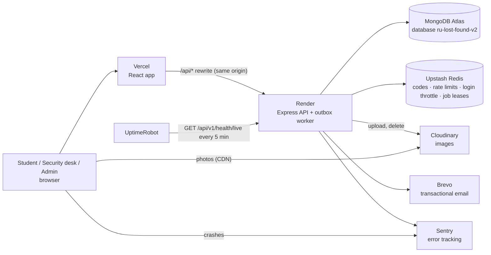

# Backend Architecture

Status: Built and live · Last updated: 29 October 2026

The backend is a **modular monolith** written in TypeScript on Node.js and Express 5. Each business capability lives in its own module. Business modules (auth, users, items, claims, matching, moderation, notifications) are split into the same layers: routes, controller, service, repository and domain; smaller modules (account, admin, desk, demo, health, audit, universities) have only the layers they need. Infrastructure (MongoDB, Redis, Cloudinary, email) sits behind interfaces, so any provider can be swapped without touching business logic.

This document explains how the backend is built and why. The diagrams of its classes, interactions and storage are in the [system design](../design/README.md); the decisions behind it, with the alternatives, are in the [architecture decision records](../adr/README.md).

---

## 1. Architectural style

**One deployable app whose modules have strict boundaries** and talk only through services and domain events, so any module can be extracted into its own service later without a rewrite. Microservices would add network calls, distributed transactions and several deployments for one developer on one free server; plain MVC mixes HTTP, business rules, database access and email in the controllers. The full comparison is in [ADR 0001](../adr/0001-modular-monolith.md).

**Layer rules** (dependencies point inwards only):

```text
Route → Controller → Service → Repository (interface) → Mongoose model
                        ↓
                  Domain entity (pure business rules, no framework imports)
```

| Layer          | Responsibility                                                                                                            | Must not                                                     |
| -------------- | ------------------------------------------------------------------------------------------------------------------------- | ------------------------------------------------------------ |
| Route          | Map URL + method to a controller; attach middleware (auth, validation, rate limit)                                        | Contain logic                                                |
| Controller     | Read the validated request, call one service method, map the result to a response DTO                                     | Touch the database or business rules                         |
| Service        | Orchestrate a use case: load entities, call domain methods, save (the repository stores the events the entities recorded) | Know about HTTP (`req`, `res`)                               |
| Domain entity  | Hold state and enforce invariants (e.g. a claim can only be approved while requested)                                     | Import Express, Mongoose or any SDK                          |
| Repository     | Load and save entities; map between Mongoose documents and domain entities                                                | Contain business rules                                       |
| Infrastructure | Implement interfaces for external systems (Redis, Cloudinary, Brevo)                                                      | Be imported directly by services (only their interfaces are) |

---

## 2. System context

Where each part runs in production and what it talks to. Every service, its plan, limits and settings are in [services.md](../services.md).



Because Vercel rewrites `/api/*` to Render, the browser sees one origin. This lets the refresh token live in a secure `httpOnly` cookie without cross-site cookie problems, and no CORS preflight is needed. Photos are the exception: the browser loads them straight from Cloudinary's CDN.

---

## 3. Repository and folder structure

```text
ru-lost-found/
├── apps/
│   ├── api/                      # TypeScript backend (this document)
│   └── web/                      # React frontend
├── packages/
│   └── shared/                   # Zod schemas, enums and DTO types used by both apps
├── docs/
│   ├── design/                   # requirements, class diagrams, interactions, database schema
│   ├── architecture/             # backend.md (this document), frontend.md
│   ├── adr/                      # architecture decision records
│   ├── deployment.md · services.md · launch-checklist.md · load-test.md · demo-data.md · branding.md · maintenance.md
│   └── screenshots/
├── load/                         # k6 load test and its data script
├── .github/                      # CI pipeline (workflows/ci.yml), Dependabot
└── package.json                  # npm workspaces root
```

```text
apps/api/src/
├── main.ts                       # Bootstrap: load config, build container, start HTTP server + worker
├── worker.ts                     # The background worker alone (when run as a separate process)
├── app.ts                        # createApp(container): Express app; mounts every module's routes
├── container.ts                  # Composition root: builds the kernel and lists the modules
├── config/env.ts                 # Environment variables validated with Zod at startup
├── core/                         # Shared kernel: interfaces and helpers, no business logic
│   ├── domain/                   # AggregateRoot, Actor (roles), Clock, IdGenerator, ImageRef
│   ├── errors/                   # AppError hierarchy
│   ├── http/                     # authenticate / authorize / authorizeCurrent, rate limiter, middleware/
│   │                             #   (requestLogger, security, validate, imageUpload, concurrencyLimit, errorHandler)
│   ├── events/                   # DomainEvent, EventHandler, EventHandlerRegistry
│   ├── modules/ · jobs/          # AppModule (routes, handlers, jobs of a module), ScheduledJob
│   ├── persistence/              # Repository, TenantScope, UnitOfWork, cursor Pagination
│   ├── audit/ · cache/ · email/ · health/ · observability/ · security/ · storage/   # ports (interfaces)
│   └── logger/                   # pino logger (redacts credentials)
├── infrastructure/               # Adapters that implement the ports
│   ├── database/                 # MongoDatabase, MongoUnitOfWork, MongoRepository base (+ OutboxWriter), schemas
│   ├── cache/                    # RedisKeyValueStore, InMemoryKeyValueStore, FallbackKeyValueStore (decorator)
│   ├── storage/                  # CloudinaryStorageProvider, LocalDiskStorageProvider,
│   │                             #   SanitizingStorageProvider (decorator), SharpImageProcessor
│   ├── email/                    # BrevoEmailSender, ConsoleEmailSender, FileEmailSender,
│   │                             #   SkipUndeliverableEmailSender (decorator)
│   ├── security/                 # BcryptPasswordHasher, JwtTokenService, keys (HKDF)
│   ├── outbox/                   # MongoOutbox, OutboxProcessor
│   ├── worker/                   # BackgroundWorker, JobScheduler
│   └── observability/            # SentryErrorReporter, createErrorReporter
├── modules/
│   ├── kernel.ts                 # What every module may use: settings, providers, repositories, middleware
│   ├── events.ts                 # The domain events and their payload schemas (contracts between modules)
│   ├── auth/                     # Codes, register, login, refresh, logout, password reset/change
│   ├── users/                    # Profile, avatar, RolePolicy, AdminAccounts (ADMIN_EMAILS)
│   ├── account/                  # Download my data, delete my account (uses items, claims, ...)
│   ├── universities/             # Tenants: each university's email domains, schools and campus places
│   ├── items/                    # Lost/found reports, search, post lifecycle (close, keep open, expiry)
│   ├── claims/                   # Claim workflow (state machine)
│   ├── desk/                     # Security desk console routes (handovers waiting, claims to decide, items held)
│   ├── matching/                 # Likely matches between lost and found posts (scored on request)
│   ├── notifications/            # In-app notifications + email handlers
│   ├── moderation/               # Flagging posts, admin review
│   ├── admin/                    # Stats (read model), posts CSV export, people management, activity log
│   ├── audit/                    # Audit log (audit_logs) and the handler that fills it
│   ├── demo/                     # Sample data for visitors (DEMO_MODE): one-click sign-in, hourly reset
│   └── health/                   # live / ready / client checks
├── docs/                         # OpenAPI document and Swagger UI
├── scripts/                      # seed, set-role, demo
└── testing/                      # Test helpers: test app, builders, fakes
```

Business modules follow the same internal layout:

```text
modules/claims/
├── domain/                       # Pure business rules: no Express, Mongoose or SDK imports
│   ├── Claim.ts                  # Entity: submit(), approve(), reject(), cancel(), completeHandover(), expire()
│   ├── ClaimState.ts             # State pattern: RequestedState, ApprovedState, TerminalState
│   ├── ClaimRepository.ts        # Repository interface (owned by the domain)
│   └── errors.ts                 # HandoverCodeIncorrectError, HandoverLockedError
├── infrastructure/
│   └── MongoClaimRepository.ts   # Mongoose schema + indexes + entity ↔ document mapping
├── claim.service.ts              # Use cases
├── claim.controller.ts
├── claim.routes.ts
├── claim.mapper.ts               # Entity → response DTO (never leaks internal fields)
├── handlers/                     # Reactions to other modules' events (CloseClaimsWhenItemEnds)
├── claims.module.ts              # Builds the module: service, controller, routes, handlers, jobs
└── *.test.ts                     # Tests sit next to the code they test
```

**How a module plugs in.** Each module's `*.module.ts` builds everything the module offers from the **kernel** (`modules/kernel.ts`: settings, providers, repositories, shared middleware) and returns an `AppModule`: its routes, its event handlers and its scheduled jobs. When it needs another module's service, that service is a named parameter, so the dependencies between modules are visible in one place, `container.ts`. The container lists the modules; `app.ts` mounts their routes in that order, the outbox worker collects their handlers and the scheduler their jobs. Adding a module is a new folder and one line in the list.

**Layers, checked by lint** (`apps/api/eslint.config.js`): `core` imports neither modules nor infrastructure; domain code imports no framework, SDK, infrastructure, controller, route or service; and a module uses another module's repository interface, never its MongoDB implementation. Tests are exempt.

---

## 4. Core abstractions (Dependency Inversion)

Services depend on these interfaces, never on concrete SDKs. Interfaces have plain names (`UserRepository`); implementations say what they are built on (`MongoUserRepository`). Each has a production implementation and a lightweight one for local development and tests.

| Interface                                                | Production                                                     | Dev / test                                                                    | Used for                                                |
| -------------------------------------------------------- | -------------------------------------------------------------- | ----------------------------------------------------------------------------- | ------------------------------------------------------- |
| `UserRepository`, `ItemRepository`, `ClaimRepository`, … | `Mongo*Repository`                                             | `Mongo*` on mongodb-memory-server                                             | Persistence                                             |
| `UnitOfWork`                                             | `MongoUnitOfWork` (session + transaction)                      | same                                                                          | Atomic multi-document writes                            |
| `OutboxWriter`                                           | `MongoOutbox`                                                  | same                                                                          | Storing domain events in the aggregate's transaction    |
| `EventHandler` (+ `EventHandlerRegistry`)                | notification, audit, claims and matching handlers (§7)         | same                                                                          | Reacting to events (delivered by `OutboxProcessor`)     |
| `KeyValueStore`                                          | `FallbackKeyValueStore` around `RedisKeyValueStore` (Upstash)  | `InMemoryKeyValueStore`                                                       | One-time codes, rate limits, login throttle, job leases |
| `StorageProvider`                                        | `SanitizingStorageProvider` around `CloudinaryStorageProvider` | `LocalDiskStorageProvider` (dev), `InMemoryStorageProvider` (tests)           | Image upload and delete                                 |
| `ImageSanitizer`                                         | `SharpImageProcessor`                                          | same                                                                          | Strip metadata, resize, re-encode                       |
| `EmailSender`                                            | `SkipUndeliverableEmailSender` around `BrevoEmailSender`       | `ConsoleEmailSender`, `FileEmailSender` (e2e), `CapturingEmailSender` (tests) | Sending email                                           |
| `PasswordHasher`                                         | `BcryptPasswordHasher` (native bcrypt)                         | same                                                                          | Hashing passwords                                       |
| `IdGenerator`                                            | `ObjectIdGenerator`                                            | same                                                                          | Ids for new aggregates before they are saved            |
| `TokenService`                                           | `JwtTokenService`                                              | same                                                                          | Access and verification tokens                          |
| `AuditTrail` / `AuditLog`                                | `MongoAuditTrail`                                              | same                                                                          | Writing and reading the audit log                       |
| `StatsReader`                                            | `MongoStatsReader`                                             | same                                                                          | Admin dashboard (read model)                            |
| `HealthIndicator`                                        | `MongoDatabase`, `RedisKeyValueStore`                          | `FakeHealthIndicator` (tests)                                                 | Readiness checks                                        |
| `ErrorReporter`                                          | `SentryErrorReporter`                                          | `noErrorReporting`, `RecordingErrorReporter` (tests)                          | Error tracking                                          |
| `Clock`                                                  | `SystemClock`                                                  | `FixedClock`                                                                  | Testable time (code expiry, claim deadlines)            |

**Dependency injection:** constructor injection, wired by hand. `container.ts` chooses the providers and builds the repositories and the kernel; each module's `*.module.ts` builds its own classes from the kernel ([ADR 0004](../adr/0004-manual-dependency-injection.md), [ADR 0012](../adr/0012-self-wiring-modules-and-event-contracts.md)). No DI library: the wiring stays visible and easy to explain, and switching a provider is a one-line change in `container.ts`.

```ts
// container.ts (excerpt): providers are chosen once, from configuration
keyValueStore: infra.redis ?? new InMemoryKeyValueStore(clock),   // Redis is then wrapped in FallbackKeyValueStore
emailSender: env.BREVO_API_KEY
  ? new BrevoEmailSender(env.BREVO_API_KEY, { address: env.EMAIL_FROM_ADDRESS, name })
  : env.DEV_EMAIL_DIR
    ? new FileEmailSender(env.DEV_EMAIL_DIR)
    : new ConsoleEmailSender(logger),

// modules/claims/claims.module.ts (excerpt): a module builds its service from the kernel
const { repositories, unitOfWork, ids, logger, audit } = kernel;
return new ClaimService({
  claims: repositories.claims, items: repositories.items, users: repositories.users,
  unitOfWork, ids, clock,
  generateHandoverCode: () => generateNumericCode(6),
  logger, audit,
});
```

---

## 5. Domain model

Seven aggregates hold the business rules: `University`, `User`, `Session`, `Item`, `Claim`, `ModerationReport` and `Notification`. Each extends `AggregateRoot` (a version for optimistic concurrency, and the domain events it recorded), keeps its state private and is created only through a named factory. The full class diagram (every aggregate, value object, enumeration, relationship and multiplicity) is in [class-diagrams.md §1](../design/class-diagrams.md#1-domain-model), the life cycles of claims, items, reports and sessions in [interactions.md](../design/interactions.md#state-diagrams), and how each class is stored in [database.md](../design/database.md). This section gives the rules that the diagrams can't show.

**University vs school:** a _University_ is a customer of the platform (a tenant), for example Rishihood University. _Schools_ such as Newton School of Technology or School of Entrepreneurship are departments inside one university. They are stored as a list on the university and shown in the sign-up form; a user's school is just a profile field and does not separate any data.

**Deployment model:** the code is multi-tenant (every query is scoped by `universityId`), but each organisation gets its **own branded deployment**: this one serves Rishihood University only. A deployment's universities come from `apps/api/seed/universities.json`, and its email branding from `BRAND_NAME`, `BRAND_PRIMARY_COLOR` and `BRAND_BACKGROUND_COLOR` (injected into `EmailLayout`, which `AuthEmails` and `NotificationEmails` build on). See [../branding.md](../branding.md).

**Roles:** `STUDENT` < `SECURITY_DESK` < `UNIVERSITY_ADMIN` < `PLATFORM_ADMIN`. Admins manage only people ranked below them (never themselves or a fellow admin, so nobody can lock themselves out or remove a peer) and may give roles up to their own rank. Every role change, suspension and reactivation is a domain event, so it lands in the audit log. The deployment's owners are listed in the `ADMIN_EMAILS` setting and made platform admins automatically (at startup, or when they sign up); `npm run set-role -- <email> <ROLE>` remains for one-off changes. Admin routes re-read the user's role and status from the database on each request (`authorizeCurrent`), so a demoted or suspended admin loses access at once instead of when the 15-minute access token expires; a suspended student's sessions are ended immediately, and posting, editing or removing a post, claiming and reporting also check the account's status (they load it anyway), so a suspended person can't keep posting on a token that still has minutes left. Other routes trust the token.

**Post lifecycle:** an open post stays up for 60 days (`expiresAt`). An hourly job (`close-stale-posts`) reminds the reporter a week before (`ItemExpiringSoon`: in the app and by email) and closes the post (`CLOSED`, reason `EXPIRED`) only once that reminder is a week old, so nothing closes without warning, also a post that fell back to open after a failed handover. "Keep it open" gives an open post another 60 days, or opens a closed one again. The reporter can also close an open post themselves: `RETURNED` (back with its owner outside the portal) or `WITHDRAWN`. Closed posts leave the feed but stay in "My items"; their open claims are closed by `CloseClaimsWhenItemEnds`, and the return rate counts them in its total, so posts nobody followed up on don't flatter it.

**Moderation:** anyone can flag a post (`ModerationReport`: reason, details; one per person per post). An admin decides on all open reports for a post at once: removing it is one transaction (item `REMOVED` + reports `ACTIONED`); its open claims are then closed by `CloseClaimsWhenItemEnds` and the poster is told why by `ItemModerationHandler`.

---

## 6. Claim workflow (State pattern)

A **claim** connects the item's reporter with another user:

- On a **FOUND** item, the claimant says "this is mine" (`OWNERSHIP`) and answers the reporter's verification questions.
- On a **LOST** item, the claimant says "I found this" (`FINDER`) and describes where it is.

Its states and transitions are drawn in [interactions.md S1](../design/interactions.md#s1-claim), the item's in [S2](../design/interactions.md#s2-item), and approval and handover step by step in [Q5](../design/interactions.md#q5-approve-a-claim) and [Q6](../design/interactions.md#q6-hand-over-with-the-code).

**Rules**

1. A user can't claim their own item and can have only one active claim per item (enforced by a partial unique index). Once the reporter rejects someone's claim on an item, that person can't claim it again (no repeated pestering); withdrawing your own claim doesn't block you.
2. Approving a claim sets the item to `RESERVED`. Only one claim per item can be `APPROVED` at a time.
3. On approval, the system generates a 6-digit **handover code** and gives it to the item's owner:
   - the claimant for a FOUND item;
   - the reporter for a LOST item.

   The person handing over the item enters the code when they meet. The code is stored readable so the owner can view it in the app, but it is only ever shown to the owner; entry is limited to 5 attempts and must happen before the deadline. A wrong code is counted and saved, not thrown, so attempts can't be reset by retrying. When the code is locked, security desk staff confirm the handover in person.

4. `COMPLETED` sets the item to `RESOLVED` and automatically rejects all other open claims on it.
5. `CANCELLED` or `EXPIRED` after approval puts the item back to `OPEN`.
6. Every transition is appended to the claim's `history` (from, to, by, at) and written to the audit log.
7. **Privacy:** before approval each side sees only the other's name and picture. After approval, the two people (never outsiders or staff) see each other's email, and a phone number only if its owner chose `sharePhone`. The handover code is only ever sent to the item's owner. An item held at the security desk is collected there: nothing is shared, and staff confirm the handover in person.
8. **The desk as a team:** claims on a found item held at the desk may be approved or declined by its reporter or by any desk staff member (role checked against the database; never on their own claim), so items handed in keep moving when the person who posted them is off shift. The console lists them under "Claims to decide" (`GET /desk/claims`).
9. Removing an item cancels its active claims; an expiry job ends approved claims whose deadline passed and reopens their items.

**Why the State pattern:** each state class decides which transitions are legal, so an illegal action, such as approving a completed claim, throws `InvalidStateTransitionError` from one place instead of scattered `if` checks, and a new state is a new class ([ADR 0009](../adr/0009-claim-state-machine.md)).

**Concurrency** is protected at three levels: claim, item and outbox writes for one action run in **one transaction** (`UnitOfWork`, using the driver's `withTransaction`, which retries transient write conflicts); every save checks the **version** that was loaded and otherwise fails with `ConcurrencyError` (409) instead of overwriting someone else's change; and **partial unique indexes** are the last line of defence: at most one active claim per person per item (`uniq_active_claim_per_claimant`) and one approved claim per item (`uniq_approved_claim_per_item`). Every consistency mechanism is listed in [database.md §4](../design/database.md#4-keeping-the-data-consistent).

---

## 7. Events, notifications and the outbox

Use cases never send notification emails themselves. There are two exceptions, both sent directly so that nothing secret or personal is stored: sign-up and password-reset codes, which `AuthService` sends straight away in the background (they must arrive at once, and the code must never be stored), and the goodbye email after an account is deleted (so the address is never written to the outbox). Aggregates record **domain events** while their business methods run (`ClaimApproved`, `ItemRemoved`, …). When a repository saves an aggregate, the `MongoRepository` base class writes its pending events to the `outbox_events` collection **in the same transaction** (the caller's, or one it starts itself). No service can forget to publish an event, and an event never exists without its change. A background worker then delivers the events.

Saving a change with its event is drawn in [interactions.md Q5](../design/interactions.md#q5-approve-a-claim), the delivery loop in [Q8](../design/interactions.md#q8-delivering-events-outbox) and an event's states in [S5](../design/interactions.md#s5-outbox-event); why an outbox and not a message broker is in [ADR 0006](../adr/0006-transactional-outbox.md).

**Delivery guarantees (at least once):**

- **Claiming:** a worker takes one event at a time with an atomic `findOneAndUpdate` and a 60-second lease. With several instances each event goes to exactly one; an event whose worker crashed is taken over when the lease runs out.
- **Per-handler progress:** each handler's success is recorded on the event (`completedHandlers`), so a retry only re-runs the handlers that failed. A healthy email is not re-sent because another handler failed.
- **Retries:** exponential back-off (30 s, 1 min, 2 min, 4 min); after 5 attempts the event is marked `FAILED` and kept for inspection.
- **Idempotent handlers:** in-app notifications have a unique index on (event id, recipient), and each notification records when its email went out (`emailedAt`), so even a redelivered event can't notify or email anyone twice. An email that failed is still sent on the retry.
- **Housekeeping:** delivered events are deleted after 7 days by the `prune-outbox` job; how long every kind of data is kept is in [database.md §5](../design/database.md#5-retention).

**Observer pattern:** handlers subscribe to event types through the `EventHandlerRegistry`. Adding a new reaction means adding a handler to a module; the module that raised the event doesn't change.

**Event contracts:** `modules/events.ts` lists every event with a schema for its payload. Aggregates build events with `domainEvent(type, …)`, so the compiler checks the payload; handlers read it with `payloadOf(event, type)`, which checks it again at run time, because stored events may come from an older version (fields added later are optional or have a default). Handlers declare their event types against the catalogue, so a misspelt name doesn't compile, and a test checks that every handled event exists.

| Handler                    | Reacts to                                                                          | Does                                                                                                                                                                                                 |
| -------------------------- | ---------------------------------------------------------------------------------- | ---------------------------------------------------------------------------------------------------------------------------------------------------------------------------------------------------- |
| `ClaimNotificationHandler` | `ClaimRequested`, `…Approved`, `…Rejected`, `…Cancelled`, `…Completed`, `…Expired` | In-app notification to the right person; email for steps that need action (a new claim, approval with the handover code, a manual rejection, a cancelled or expired handover)                        |
| `AccountSecurityHandler`   | `PasswordChanged`, `UserSuspended`, `UserReactivated`                              | Account emails: "if this wasn't you…", the suspension reason, "you can sign in again"                                                                                                                |
| `CloseClaimsWhenItemEnds`  | `ItemRemoved`, `ItemClosed`                                                        | Cancels the item's active claims, saying why (removed, closed by its reporter, or closed after nobody kept it open). The items module never calls the claims module directly: modules stay decoupled |
| `AuditEventHandler`        | Account, item, claim, role and moderation events                                   | Writes the matching `audit_logs` entry (idempotent: one entry per event)                                                                                                                             |
| `ItemModerationHandler`    | `ItemRemoved` (by an admin)                                                        | Tells the poster their post was removed, with the admin's reason (in the app and by email)                                                                                                           |
| `ItemLifecycleHandler`     | `ItemExpiringSoon`, `ItemClosed` (expired)                                         | Reminds the reporter a week before the post closes (in the app and by email, with a link to keep it open); tells them in the app when it closed by itself                                            |
| `TellOwnersOfLikelyFinds`  | `ItemReported` (found posts)                                                       | Tells the owners of up to 3 strongly matching lost posts, in the app and by email (matching module)                                                                                                  |

**Scheduled jobs**, run by the same worker. A lease in the shared key-value store (Redis) makes each job run on only one instance per interval; if the lease can't be taken, that run is skipped and reported, never left to crash the process. Each job also gets a turn about 30 seconds after start-up, because every deploy restarts the process: without it an hourly job would wait an hour after each deploy and a daily one might never run. The lease outlives the process, so a job some instance ran within its interval is still skipped. The demo reset is the exception: it waits its first hour, since start-up already sets up the sample data.

| Job                         | Every  | Does                                                                                                     |
| --------------------------- | ------ | -------------------------------------------------------------------------------------------------------- |
| `expire-claims`             | 5 min  | Expires approved claims past their handover deadline and reopens their items (one transaction per claim) |
| `close-stale-posts`         | 1 hour | Reminds reporters of posts closing within a week and closes posts whose reminder is a week old           |
| `purge-removed-item-photos` | 1 hour | Deletes photos of items removed more than 30 days ago (the moderation window)                            |
| `prune-outbox`              | 1 day  | Deletes delivered events older than 7 days                                                               |
| `reset-demo-data`           | 1 hour | Only with `DEMO_MODE=true`: puts the sample data back as it was ([demo-data.md](../demo-data.md))        |

The worker runs inside the API process on the free tier (`WORKER_ENABLED=true`). On a paid plan it becomes a separate process (`npm run start:worker`, API with `WORKER_ENABLED=false`) with no code change.

---

## 8. Matching

**Campus places.** Each university lists its places (library, blocks, residences, cafés, ...) in `seed/universities.json`, next to its schools. A post names one of them, checked like a school at sign-up, or none ("Other" in the form); the free-text `location` is then the exact spot inside the place (a room in a block), or for "Other" the place itself. Posts saved before places existed simply have none.

**Scoring** (`modules/matching/domain/matchScore.ts`, a pure function). A lost post and a found post can only match if they share the **category** and the item was found from 2 days before (dates are picked by hand) to 30 days after it was lost. Then:

| Part  | Weight | How                                                                                                                                                                               |
| ----- | ------ | --------------------------------------------------------------------------------------------------------------------------------------------------------------------------------- |
| Words | 45%    | Shared distinctive words of title and description (filler words such as "lost", "near" and plural endings ignored), relative to the shorter text, so a terse post isn't penalised |
| Date  | 30%    | 1 on the same day, falling to 0 at 30 days apart                                                                                                                                  |
| Place | 25%    | 1 for the same place, 0 for different places, 0.5 when either is unknown                                                                                                          |

From 0.45 a pair is shown, from 0.65 it is a strong match. The threshold is above what the same category, date and an unknown place earn without a single shared word (0.43), so unrelated items of a category aren't suggested.

**Where it shows.** `GET /items/:id/matches` gives the reporter of an open post up to 5 matches from the other side, best first, scored when asked from at most 50 recent candidates: nothing is stored, so a suggestion disappears as soon as either post closes. When a **found** post is reported, `TellOwnersOfLikelyFinds` (reacting to `ItemReported`) tells the owners of up to 3 strongly matching lost posts, in the app and by email. Sample posts of the demo only ever match sample posts.

**Why rules, not search scores or embeddings:** a few hundred open posts per university make on-request scoring cheap, the reasons for a suggestion are easy to explain to a student, and every rule is a unit test. A smarter scorer (image similarity, embeddings) would replace one function.

---

## 9. Authentication and security

| Concern                    | Design                                                                                                                                                                                                                                                                                                                                                                                                                                                                                                                                                                                                                                                                                                                                                                                                                                                                                                                                                                                                                   |
| -------------------------- | ------------------------------------------------------------------------------------------------------------------------------------------------------------------------------------------------------------------------------------------------------------------------------------------------------------------------------------------------------------------------------------------------------------------------------------------------------------------------------------------------------------------------------------------------------------------------------------------------------------------------------------------------------------------------------------------------------------------------------------------------------------------------------------------------------------------------------------------------------------------------------------------------------------------------------------------------------------------------------------------------------------------------ |
| Sign-up                    | Email must match a university's `emailDomains` (subdomains included). `"*"` in the list opens sign-up to any address, used now so visitors can try the portal; an exact domain match always wins over `"*"`. The emailed code still proves every address is real. Two steps: a one-time code proves the email (→ 30-minute verification token), then the account is created with that token.                                                                                                                                                                                                                                                                                                                                                                                                                                                                                                                                                                                                                             |
| One-time codes             | 6 digits from a cryptographic RNG. Only an HMAC is stored (Redis, 10-minute TTL), 5 guesses per code, deleted after use, one new code per minute per email, and at most 10 wrong codes per email per day across all codes (asking for fresh codes can't speed up guessing).                                                                                                                                                                                                                                                                                                                                                                                                                                                                                                                                                                                                                                                                                                                                              |
| Secrets                    | One `APP_SECRET`; independent keys for access tokens, verification tokens and code hashing are derived from it with HKDF.                                                                                                                                                                                                                                                                                                                                                                                                                                                                                                                                                                                                                                                                                                                                                                                                                                                                                                |
| Account enumeration        | Code requests answer the same for known and unknown emails (an existing account gets a "you already have an account" email instead of a code), and code emails are sent in the background so response times match too. "Forgot password" answers the same whether or not the email exists. Login returns one message for a wrong email or password and hashes a dummy password for unknown emails so timing matches.                                                                                                                                                                                                                                                                                                                                                                                                                                                                                                                                                                                                     |
| Password reset and change  | The reset's verification token carries a fingerprint of the current password hash, so it stops working once the password changes (single use). Resetting ends every session. Changing the password while signed in (`POST /auth/password/change`) needs the current one; wrong ones count as failed sign-ins (same `LoginThrottle`), so a stolen access token can't be used to guess it. Every session ends and the device that made the change gets a new one.                                                                                                                                                                                                                                                                                                                                                                                                                                                                                                                                                          |
| Deleting an account        | `DELETE /account` asks for the password again (throttled the same way). It reuses the normal use cases, so the other people involved are told: active claims are cancelled (an approved one reopens its item), open posts removed (their claims closed by `CloseClaimsWhenItemEnds`). Then the user document is deleted for good, with their sessions, notifications and picture. Finished handovers stay; the missing user shows as "Former member" (`toPersonSummary`). The goodbye email is sent directly, so the address is never written to the outbox. Each step only touches what is left, so a failed deletion can be retried. Demo accounts are refused.                                                                                                                                                                                                                                                                                                                                                        |
| Data export                | `GET /account/export` returns the profile, every post (removed ones included), claims made and received, and notifications as a JSON file; never the password hash.                                                                                                                                                                                                                                                                                                                                                                                                                                                                                                                                                                                                                                                                                                                                                                                                                                                      |
| Passwords                  | bcrypt; minimum 8 characters, at least one letter and one number.                                                                                                                                                                                                                                                                                                                                                                                                                                                                                                                                                                                                                                                                                                                                                                                                                                                                                                                                                        |
| Access token               | JWT (HS256), 15 minutes, payload `{ sub, uid (university id), role }`, sent as `Authorization: Bearer`; the frontend keeps it in memory only.                                                                                                                                                                                                                                                                                                                                                                                                                                                                                                                                                                                                                                                                                                                                                                                                                                                                            |
| Refresh token              | Random 256-bit value in an `httpOnly`, `Secure` (in production), `SameSite=Lax` cookie (7 days) sent only to `/api/v1/auth`, stored as a SHA-256 hash in `sessions` (MongoDB deletes expired ones via a TTL index). **Rotated on every use**; replaying an old _rotated_ token ends the whole session family (theft detection; tokens ended by sign-out, a password change or a suspension are simply refused), except within 30 seconds of rotation: while the device is still signed in, such a token gets a new one in the same family, because the browser may never have stored the answer to its last refresh (a page left mid-refresh, a dropped connection) or two tabs refreshed at once. A signed-out family is never revived. Rotation runs in a transaction whose body is safe for the driver to retry, so simultaneous refreshes don't fail. _Accepted trade-off:_ a thief who replays within those 30 seconds gets a token too and is not detected; signing out ends it along with the rest of the family. |
| Authorization              | `authorize(...roles)` middleware for roles (admin routes use `authorizeCurrent`, which re-reads the role from the database), plus ownership and role rules in the domain (e.g. only the reporter approves claims; `RolePolicy` for who may manage whom).                                                                                                                                                                                                                                                                                                                                                                                                                                                                                                                                                                                                                                                                                                                                                                 |
| Multi-university isolation | Every tenant-owned repository method (items, claims, reports, audit log, stats) takes a `TenantScope` built from the token's university, so such a query can't be written without it. Users are looked up by id or email (emails are unique platform-wide) and checked against the scope in the service; notifications belong to one user.                                                                                                                                                                                                                                                                                                                                                                                                                                                                                                                                                                                                                                                                               |
| Rate limiting              | Redis-backed. Per-IP limits are generous because a whole campus may share one IP (NAT); tight limits are per email or account: code requests, failed logins (10 per account and IP per 15 min, 50 per account per hour, only failures count so nobody can lock someone else out), 20 item reports and 20 avatar uploads per user per day. A general cap of 120 writes per IP per minute (setting `WRITE_LIMIT_PER_MINUTE`; the end-to-end tests raise it because every simulated person shares one IP); session refreshes don't count towards it, because every signed-in browser sends them and a whole campus or mobile network can share one address (they have their own limit, 600 per IP per minute); reads aren't counted because each check costs a Redis command on the metered free tier.                                                                                                                                                                                                                      |
| Client IP                  | `TRUST_PROXY_HOPS` tells Express how many proxies sit in front of the app. Measured in production with `GET /health/client`: visitor → Vercel → Cloudflare → Render's load balancer → app, so **4**. It must be set explicitly in production: too low and all users share one rate-limit bucket, too high and clients can fake their IP. Trade-off: someone calling Render directly (bypassing Vercel) passes one hop fewer and could fake their address, dodging the per-IP limits only; the tight limits are per email and per account, which a fake IP doesn't affect.                                                                                                                                                                                                                                                                                                                                                                                                                                                |
| Uploads                    | Type checked from file bytes, then **every image is re-encoded** (`SanitizingStorageProvider` decorator + sharp): metadata such as GPS location is removed, orientation applied, resized to ≤ 2000 px, stored as WebP. Decompression bombs (> 40 MP) are refused before decoding. At most 4 uploads are processed at once per instance (503 + `Retry-After` beyond that) so parallel uploads can't exhaust memory.                                                                                                                                                                                                                                                                                                                                                                                                                                                                                                                                                                                                       |
| HTTP headers and CORS      | JSON-only API: `Content-Security-Policy: default-src 'none'; frame-ancestors 'none'`, `Cross-Origin-Resource-Policy: same-site`, `Referrer-Policy: no-referrer`, `Cache-Control: no-store` on every response (personal data), HSTS and the other `helmet` defaults; CORS allows only the origins in `CORS_ORIGINS`.                                                                                                                                                                                                                                                                                                                                                                                                                                                                                                                                                                                                                                                                                                      |
| CSRF                       | The refresh and logout endpoints are the only ones authenticated by a cookie. Protected by SameSite=Lax **and** an `Origin` check against the allowed origins.                                                                                                                                                                                                                                                                                                                                                                                                                                                                                                                                                                                                                                                                                                                                                                                                                                                           |
| Timeouts                   | Keep-alive 65 s (longer than the load balancer's), headers 66 s, whole request 120 s (slow mobile uploads, but no slow-loris).                                                                                                                                                                                                                                                                                                                                                                                                                                                                                                                                                                                                                                                                                                                                                                                                                                                                                           |
| Audit log                  | Append-only `audit_logs` (1-year retention): logins and failures with reason and IP, detected token theft, password changes, account deletions, item removals, every claim decision, staff-confirmed handovers, handover-code lock-outs, role changes, suspensions, and moderation reports and decisions. Most entries come from domain events through the outbox (so an action is logged if and only if it happened); secrets such as codes are never stored.                                                                                                                                                                                                                                                                                                                                                                                                                                                                                                                                                           |
| Input                      | Every request body, query and param is validated with Zod; unknown fields are rejected.                                                                                                                                                                                                                                                                                                                                                                                                                                                                                                                                                                                                                                                                                                                                                                                                                                                                                                                                  |
| Output                     | Responses are built by mappers (DTOs). Emails, phone numbers and internal fields are never exposed in lists.                                                                                                                                                                                                                                                                                                                                                                                                                                                                                                                                                                                                                                                                                                                                                                                                                                                                                                             |
| Email content              | Templates escape all user input (`html` tagged template); brand colours are validated hex values.                                                                                                                                                                                                                                                                                                                                                                                                                                                                                                                                                                                                                                                                                                                                                                                                                                                                                                                        |
| Errors                     | Clients get a stable error code and message; stack traces and internal messages only go to logs and Sentry.                                                                                                                                                                                                                                                                                                                                                                                                                                                                                                                                                                                                                                                                                                                                                                                                                                                                                                              |

---

## 10. API design

Base path: `/api/v1`. Request and response bodies are JSON (except image uploads, which are `multipart/form-data`) and share Zod schemas from `packages/shared`.

**Error format**

```json
{
  "error": {
    "code": "INVALID_STATE_TRANSITION",
    "message": "This claim cannot be approved because it is completed.",
    "requestId": "3cb1c1ec-58ca-4bb7-8449-d840cdf054cc"
  }
}
```

`details` (a list of `{ path, message }`, e.g. `body.title`) is present only for validation errors. Every code is listed in `packages/shared/src/errors.ts`.

**Pagination:** cursor-based (`?limit=20&cursor=<opaque>` → `{ data, nextCursor }`), ordered by `createdAt, _id`. Unlike page numbers, it stays fast on large collections and doesn't skip or repeat items when new posts arrive.

### Endpoints

| Method                   | Path                          | Auth                                     | Purpose                                                                                                                                                                                        |
| ------------------------ | ----------------------------- | ---------------------------------------- | ---------------------------------------------------------------------------------------------------------------------------------------------------------------------------------------------- |
| **Auth**                 |                               |                                          |                                                                                                                                                                                                |
| POST                     | `/auth/otp`                   | –                                        | Email a 6-digit code (`purpose`: `SIGNUP` or `PASSWORD_RESET`); same 202 answer whether or not the email has an account                                                                        |
| POST                     | `/auth/otp/verify`            | –                                        | Check the code → short-lived verification token (+ the university's schools for sign-up)                                                                                                       |
| POST                     | `/auth/register`              | –                                        | Create the account with the verification token; signs in                                                                                                                                       |
| POST                     | `/auth/login`                 | –                                        | Returns access token, sets refresh cookie                                                                                                                                                      |
| POST                     | `/auth/refresh`               | cookie                                   | Rotate refresh token, return new access token                                                                                                                                                  |
| POST                     | `/auth/logout`                | cookie                                   | Sign out this device: ends its whole session family in one atomic update, so a refresh racing the sign-out can't conflict or survive                                                           |
| POST                     | `/auth/password/reset`        | –                                        | New password with the verification token; ends every session                                                                                                                                   |
| POST                     | `/auth/password/change`       | user                                     | New password with the current one; ends every other session and returns this device's new one (like a sign-in)                                                                                 |
| GET                      | `/auth/demo`                  | –                                        | Whether one-click demo sign-in is offered (`DEMO_MODE`)                                                                                                                                        |
| POST                     | `/auth/demo`                  | –                                        | Sign in as a sample person (`persona`); 404 unless `DEMO_MODE=true`; rate limited per IP                                                                                                       |
| **Users**                |                               |                                          |                                                                                                                                                                                                |
| GET                      | `/users/me`                   | user                                     | Own profile                                                                                                                                                                                    |
| PATCH                    | `/users/me`                   | user                                     | Update profile                                                                                                                                                                                 |
| PUT                      | `/users/me/avatar`            | user                                     | Upload profile picture (multipart field `avatar`, ≤ 2 MB); the old file is deleted                                                                                                             |
| DELETE                   | `/users/me/avatar`            | user                                     | Remove profile picture                                                                                                                                                                         |
| GET                      | `/universities/current`       | user                                     | My university: name, schools and campus places                                                                                                                                                 |
| **Account**              |                               |                                          |                                                                                                                                                                                                |
| GET                      | `/account/export`             | user                                     | Download my data: profile, posts, claims made and received, notifications (JSON file); 10 per hour                                                                                             |
| DELETE                   | `/account`                    | user                                     | Delete my account (`password`); see "Deleting an account" in §9                                                                                                                                |
| **Items**                |                               |                                          |                                                                                                                                                                                                |
| GET                      | `/items`                      | user                                     | Search and filter (`q` words, `type`, `category`, `place`, `occurredFrom`/`occurredTo` = days lost or found, included; `status` = comma list, default `OPEN,RESERVED`; `cursor`, `limit` ≤ 50) |
| GET                      | `/items/counts`               | user                                     | How many posts each browse tab has (All, Lost, Found, Returned), for the same words, category, place and days                                                                                  |
| POST                     | `/items`                      | user                                     | Report an item: multipart form, 1–3 photos in `photos` (≤ 5 MB each), optional `questions` (found items only); 20 per user per day                                                             |
| GET                      | `/items/:id`                  | user                                     | Item details                                                                                                                                                                                   |
| GET                      | `/items/:id/matches`          | owner                                    | Likely matches on the other side (lost ↔ found), up to 5, best first; see §8                                                                                                                   |
| PATCH                    | `/items/:id`                  | owner                                    | Edit own item while `OPEN`                                                                                                                                                                     |
| DELETE                   | `/items/:id`                  | owner, admin                             | Soft delete (`REMOVED`): hidden everywhere, kept for moderation; photos deleted later by a clean-up job                                                                                        |
| POST                     | `/items/:id/close`            | owner                                    | Close an open post: `RETURNED` or `WITHDRAWN`; its open claims close                                                                                                                           |
| POST                     | `/items/:id/keep-open`        | owner                                    | Another 60 days for an open post, or open a closed one again                                                                                                                                   |
| GET                      | `/items/mine`                 | user                                     | Items I reported, in every status except removed                                                                                                                                               |
| **Claims**               |                               |                                          |                                                                                                                                                                                                |
| POST                     | `/items/:id/claims`           | user                                     | Submit a claim: message, answers to the verification questions, `sharePhone`; 30 per user per day                                                                                              |
| GET                      | `/items/:id/claims`           | reporter, staff                          | Claims on one item (filter `status`, cursor)                                                                                                                                                   |
| GET                      | `/claims/mine`                | user                                     | Claims I submitted; `?itemId=` limits them to one item (the item page uses it to show "you already claimed this")                                                                              |
| GET                      | `/claims/received`            | user                                     | Claims others made on my items                                                                                                                                                                 |
| GET                      | `/claims/:id`                 | parties, staff                           | Claim details; outsiders get 404                                                                                                                                                               |
| POST                     | `/claims/:id/approve`         | reporter, desk staff (items at the desk) | Approve (`sharePhone`); reserves the item and issues the handover code                                                                                                                         |
| POST                     | `/claims/:id/reject`          | reporter, desk staff (items at the desk) | Reject with an optional reason                                                                                                                                                                 |
| POST                     | `/claims/:id/cancel`          | parties                                  | Withdraw; an approved claim's item reopens                                                                                                                                                     |
| POST                     | `/claims/:id/handover`        | finder                                   | Enter the owner's code → `COMPLETED`, item `RESOLVED`, other claims rejected. Wrong code → 400 `HANDOVER_CODE_INCORRECT` (attempts left); locked → 409 `HANDOVER_LOCKED`                       |
| POST                     | `/claims/:id/handover/staff`  | security desk, admin                     | Confirm a handover witnessed in person (e.g. after the code locks)                                                                                                                             |
| **Security desk**        |                               |                                          |                                                                                                                                                                                                |
| GET                      | `/desk/handovers`             | security desk, admin                     | Approved claims of the university waiting for their handover, newest first (no codes or contact details); role checked against the database                                                    |
| GET                      | `/desk/claims`                | security desk, admin                     | Claims waiting for a decision on found items held at the desk (any desk staff member may decide)                                                                                               |
| GET                      | `/desk/items`                 | security desk, admin                     | Found items handed in at the desk, open or reserved (`q` words, cursor)                                                                                                                        |
| **Notifications**        |                               |                                          |                                                                                                                                                                                                |
| GET                      | `/notifications`              | user                                     | Newest first, `unread=true` to filter, cursor; includes `unreadCount` for the badge                                                                                                            |
| POST                     | `/notifications/read`         | user                                     | Mark the given `ids` (or all) as read; only the caller's own                                                                                                                                   |
| **Moderation and admin** |                               |                                          |                                                                                                                                                                                                |
| POST                     | `/items/:id/reports`          | user                                     | Flag a post (reason, optional details); one report per person per post; 20 per user per day                                                                                                    |
| GET                      | `/admin/reports`              | admin                                    | Review queue (`status=OPEN` or `RESOLVED`, cursor)                                                                                                                                             |
| POST                     | `/admin/items/:id/moderation` | admin                                    | Decide every open report on a post at once: `REMOVE_ITEM` (with a note shown to the poster) or `DISMISS`                                                                                       |
| GET                      | `/admin/stats`                | admin                                    | Dashboard: users by role, items by status, recovery rate, average days to return, claims by status, open reports, last 8 weeks; lost, found and returned posts by category and by campus place |
| GET                      | `/admin/export/posts`         | admin                                    | The posts of a period (`from` inclusive, `until` exclusive) as a CSV file: what happened to each, never who; formula-like cells kept as text                                                   |
| GET                      | `/admin/users`                | admin                                    | Search people (`q` name/email prefix, `role`, `status`, cursor)                                                                                                                                |
| PATCH                    | `/admin/users/:id/role`       | admin                                    | Change a role (only for people ranked below you; roles up to your own)                                                                                                                         |
| POST                     | `/admin/users/:id/suspend`    | admin                                    | Suspend with a reason: blocks sign-in, ends every session, emails the user                                                                                                                     |
| POST                     | `/admin/users/:id/reactivate` | admin                                    | Undo a suspension                                                                                                                                                                              |
| GET                      | `/admin/audit`                | admin                                    | Activity log of the university: `action`, person (`actorId`), record (`targetId`), time range (`from` inclusive, `until` exclusive, ISO moments), cursor                                       |
| GET                      | `/admin/items`                | admin                                    | Every post, removed ones included (`q`, `type`, `category`, `status` comma list), cursor                                                                                                       |
| POST                     | `/admin/items/:id/remove`     | admin                                    | Remove any post (also the admin's own, also after handover) with a `reason` for the poster; its open reports are closed in the same transaction                                                |
| **Health**               |                               |                                          |                                                                                                                                                                                                |
| GET                      | `/health/live`                | –                                        | Process is up (UptimeRobot ping)                                                                                                                                                               |
| GET                      | `/health/ready`               | –                                        | MongoDB and Redis reachable                                                                                                                                                                    |
| GET                      | `/health/client`              | –                                        | How the API sees the caller: client IP and proxy chain (to check `TRUST_PROXY_HOPS`)                                                                                                           |
| **Documentation**        |                               |                                          |                                                                                                                                                                                                |
| GET                      | `/openapi.json`, `/docs`      | –                                        | OpenAPI 3.1 document and Swagger UI (`API_DOCS_ENABLED`)                                                                                                                                       |

Interactive documentation is served at `/api/v1/docs` (Swagger UI from the installed package, under its own content security policy; OpenAPI 3.1 at `/api/v1/openapi.json`). Request schemas are generated from the same Zod schemas that validate them, and a test checks the document against the routes both ways (§14).

---

### Image uploads

1. `multer` parses the multipart form **in memory** within strict limits (file count, size, number of fields), so nothing touches the server's disk.
2. Each file's **real type is read from its first bytes** (JPEG / PNG / WebP signatures). The client's Content-Type and file name are ignored, so a script renamed to `.jpg` is rejected.
3. The service uploads the photos in parallel through `StorageProvider`, then saves the item. If an upload or the save fails, the photos already uploaded are deleted again (a **compensating action**), so storage never collects orphans.
4. Cloudinary URLs carry a delivery transformation (`f_auto,q_auto,c_limit,w_1600`): each browser gets WebP/AVIF, compressed, at most 1600 px wide, without storing extra copies.

Without Cloudinary credentials (development), `LocalDiskStorageProvider` saves files under `apps/api/.uploads` and the API serves them at `/api/v1/uploads`. Production refuses to start without Cloudinary, because hosting platforms wipe local disks on every deploy.

_Scaling note:_ photos pass through the API. At larger scale the next step is **direct signed uploads** (the browser uploads straight to Cloudinary with a short-lived signature and sends only the resulting ids), which takes the upload bandwidth off the API servers.

### Search

`GET /items` uses MongoDB's text index on title (weight 5), location (3) and description (1). It matches whole words with English stemming ("keys" finds "key"), combined with the type, category, status, campus place and day-range filters and cursor pagination, newest first. The list and the tab counts build the place and day part of their query with one helper, so a tab always counts what it lists. Reporter names for a page are loaded with **one** batch query (`findByIds`), not one query per item (avoids the N+1 problem).

_Upgrade path:_ prefix and typo-tolerant search ("wal" → "wallet") would use Atlas Search (a Lucene index, available on the free tier) behind the same repository method.

## 11. Error handling

Every error the API reports on purpose is an `AppError` subclass that fixes its HTTP status and error code: `ValidationError` 400 (with `HandoverCodeIncorrectError`), `UnauthorizedError` 401, `ForbiddenError` 403, `NotFoundError` 404, `ConflictError` 409 (with `InvalidStateTransitionError`, `ConcurrencyError` and `HandoverLockedError`), `PayloadTooLargeError` 413, `RateLimitError` 429 and `ServiceBusyError` 503 (both with `Retry-After`), and `ExternalServiceError` 502. The hierarchy is drawn in [class-diagrams.md §2](../design/class-diagrams.md#2-inheritance-hierarchies), and the path of a request through validation and error handling in [interactions.md A3](../design/interactions.md#a3-one-request-through-the-api).

One `errorHandler` middleware converts `AppError` into the error format above. Anything else becomes a generic 500; unexpected errors, and `AppError`s of 500 or more except "server busy", are reported through `ErrorReporter` (Sentry when `SENTRY_DSN` is set). Multer and JSON parsing errors are converted too, so clients always get JSON.

---

## 12. Design principles and patterns: where and why

### Object-oriented design

| Principle         | Where                                                                                                                                                                                                                          |
| ----------------- | ------------------------------------------------------------------------------------------------------------------------------------------------------------------------------------------------------------------------------ |
| **Abstraction**   | Services see only interfaces (`StorageProvider`, `EmailSender`, `ClaimRepository`, `UnitOfWork`, `Clock`, ...; table in §4), never an SDK or MongoDB                                                                           |
| **Encapsulation** | Aggregates keep their state in a private `props` object behind read-only getters; constructors are private, so objects are created only by named factories and changed only by methods that check their rules first            |
| **Inheritance**   | `AggregateRoot` (versions and domain events) under all 7 aggregates; the `AppError` hierarchy; `MongoRepository` under all 7 repositories; `ClaimState` under its 3 states                                                     |
| **Polymorphism**  | `claim.approve()` asks its current `ClaimState`, whose subclass decides; the error handler treats every `AppError` subclass alike through `httpStatus` and `code`; any `StorageProvider` or `EmailSender` is used the same way |

The classes and their relationships are drawn in [../design/class-diagrams.md](../design/class-diagrams.md).

### SOLID

| Principle                 | Where it is applied                                                                                                                                                                                                                                                                                                               | Why                                                                                              |
| ------------------------- | --------------------------------------------------------------------------------------------------------------------------------------------------------------------------------------------------------------------------------------------------------------------------------------------------------------------------------- | ------------------------------------------------------------------------------------------------ |
| **S**ingle Responsibility | Route, controller, service, domain entity, repository and mapper are separate classes per module (e.g. `ClaimController` only reads the request and maps the answer; `toClaimDto` only decides what each viewer may see; `matchScore` only scores)                                                                                | Each changes for one reason: a new field in the response touches only the mapper                 |
| **O**pen/Closed           | A new claim state is a new `ClaimState` subclass; a new reaction to an event is a new `EventHandler` registered by its module (the module raising the event is unchanged); a new storage behaviour is a decorator; a new module is a folder plus one line in `container.ts`                                                       | New behaviour is added as new classes, not by editing tested ones                                |
| **L**iskov Substitution   | Every `KeyValueStore` must pass the same behavioural test suite (`keyValueStore.contract.test.ts`): in-memory, Redis, and the fallback decorator both while Redis answers and while it is down; `DemoClock`, `FixedClock` and `SystemClock` stand in for one another; decorated providers stand in for plain ones                 | Substitution is proven by a shared test, not assumed: tests run on fakes with no special cases   |
| **I**nterface Segregation | `MongoAuditTrail` implements two interfaces: `AuditTrail` (write) for services and handlers, `AuditLog` (read) for the admin screen; `StorageProvider` has only `upload` and `delete`; services that use Redis as a store never see its `HealthIndicator` side; `SessionManager` asks only for `Pick<UserRepository, 'findById'>` | Each client depends only on the methods it calls                                                 |
| **D**ependency Inversion  | Services depend on interfaces defined in `core/` or in the module's own `domain/` (`ClaimRepository` lives next to `Claim`, its Mongo implementation in `infrastructure/`); `container.ts` picks the implementations; lint rules stop domain code importing infrastructure                                                        | High-level rules don't depend on MongoDB, Redis or any vendor; free to paid is a one-line change |

### Design patterns

| Pattern               | Kind          | Where                                                                                                                                                                                                                                     | Why it was chosen                                                                                                                                                                                                         |
| --------------------- | ------------- | ----------------------------------------------------------------------------------------------------------------------------------------------------------------------------------------------------------------------------------------- | ------------------------------------------------------------------------------------------------------------------------------------------------------------------------------------------------------------------------- |
| Factory Method        | Creational    | Static factories on every aggregate: `Item.report`, `Claim.submit`, `User.register`, `Session.start`, `ModerationReport.file`, `Notification.create`, `University.create`; `restore` for loading                                          | A named way to create a valid object: the factory checks the rules and records the first event, and the private constructor makes any other way impossible                                                                |
| Factory (functions)   | Creational    | `createApp`, `createErrorReporter` (Sentry or none, from configuration), one `create…Module(kernel)` per module, `createClaimService`, `createModerationService`                                                                          | Building an object graph is one function's job; the caller doesn't know which concrete classes it gets                                                                                                                    |
| Builder (test data)   | Creational    | `testing/builders.ts`: `aUser`, `aFoundItem`, `aLostItem`, `aClaimOn`, `aUniversity`, `anActor` take only the fields a test cares about and fill in valid defaults                                                                        | Tests stay short and readable, and a new required field changes one builder, not hundreds of tests. (Builder functions with overrides, not a fluent builder class: the objects are created in one step by their factory.) |
| Singleton (not used)  | Creational    | Every service, repository and provider is created **once**, in the composition root, and passed in through constructors                                                                                                                   | One instance per process without a global: a classic Singleton hides dependencies and can't be replaced by a fake in tests. Shared stateless values are module constants instead (the claim states, see Flyweight)        |
| Adapter               | Structural    | `CloudinaryStorageProvider`, `BrevoEmailSender`, `SentryErrorReporter`, `BcryptPasswordHasher`, `JwtTokenService`, `RedisKeyValueStore`                                                                                                   | Wrap third-party SDKs behind our own interfaces, so a vendor change touches one class                                                                                                                                     |
| Decorator             | Structural    | `SanitizingStorageProvider` wraps any storage provider; `FallbackKeyValueStore` wraps Redis; `SkipUndeliverableEmailSender` wraps any email sender                                                                                        | Add a behaviour (photo cleaning, outage fallback, skipping test domains) to every implementation without changing it or its callers                                                                                       |
| Flyweight             | Structural    | One shared instance per claim status (`claimStateFor`)                                                                                                                                                                                    | States hold no per-claim data, so thousands of claims share six objects                                                                                                                                                   |
| Repository            | Structural    | `*Repository` interfaces in each module's `domain/`, `Mongo*Repository` implementations                                                                                                                                                   | Business logic speaks in domain terms and never sees MongoDB                                                                                                                                                              |
| State                 | Behavioural   | `Claim` + `ClaimState` (`RequestedState`, `ApprovedState`, `TerminalState`)                                                                                                                                                               | Legal transitions defined in one place; an illegal one fails the same way everywhere ([ADR 0009](../adr/0009-claim-state-machine.md))                                                                                     |
| Strategy              | Behavioural   | Interchangeable implementations of `EmailSender`, `StorageProvider`, `KeyValueStore`, `ErrorReporter` and `Clock`, chosen in `container.ts` from configuration (Brevo or console or file; Cloudinary or local disk; system or demo clock) | The behaviour that varies by environment is one object handed to the service; the service's code is the same in production, development and tests                                                                         |
| Observer              | Behavioural   | Domain events → `EventHandlerRegistry` → handlers                                                                                                                                                                                         | Side effects (notifications, emails, audit, closing claims, matching) are decoupled from the use cases that cause them                                                                                                    |
| Template Method       | Behavioural   | `MongoRepository` base class: insert, versioned update, outbox write and error translation are fixed; subclasses only implement `toEntity` and `toDocument`                                                                               | Persistence rules written once for every collection                                                                                                                                                                       |
| Policy                | Behavioural   | `RolePolicy` (who may manage whom, which roles they may give), used by the `User` aggregate                                                                                                                                               | One place for the authorisation rule; tested without HTTP                                                                                                                                                                 |
| Unit of Work          | Architectural | `MongoUnitOfWork`                                                                                                                                                                                                                         | Atomic changes across claim, item and outbox                                                                                                                                                                              |
| Transactional Outbox  | Architectural | `outbox_events` + `OutboxProcessor`                                                                                                                                                                                                       | Reliable notifications without a message broker ([ADR 0006](../adr/0006-transactional-outbox.md))                                                                                                                         |
| Composition Root / DI | Architectural | `container.ts` builds the kernel and lists the modules; each `*.module.ts` wires its own classes                                                                                                                                          | One place to see the modules and how they depend on each other; each module's wiring stays next to its code                                                                                                               |
| CQRS (read model)     | Architectural | `StatsReader` / `MongoStatsReader`, `PostExportReader`: dashboard counts and the CSV come straight from database aggregations, not from domain objects                                                                                    | Reads shaped for the screen; writes keep the rich domain model                                                                                                                                                            |
| DTO / Mapper          | Architectural | `*.mapper.ts`                                                                                                                                                                                                                             | Never leak internal or private fields                                                                                                                                                                                     |

---

## 13. Observability and operations

- **Logging:** pino JSON logs with a `requestId` on every line (also returned in the `X-Request-Id` header).
- **Errors:** an `ErrorReporter` interface (Sentry adapter when `SENTRY_DSN` is set, otherwise nothing). Reported: unexpected 5xx errors in requests (tagged with request ID, route and user ID), event handlers once retrying stops, failed scheduled jobs, and startup or unhandled-promise failures. Expected errors (validation, 404, 409, rate limits, "server busy") are never reported. No personal data is sent: no cookies, headers, bodies, query strings or IPs. The web app reports render crashes from its error boundary; its Sentry SDK is loaded only when a DSN is configured.
- **Health:** `/health/live` for UptimeRobot (keeps the free Render instance awake and alerts on downtime); `/health/ready` checks dependencies.
- **Graceful shutdown:** on `SIGTERM`, stop accepting requests, finish in-flight ones, stop the worker, close DB and Redis connections.
- **Config:** all settings from environment variables, validated at startup; the app refuses to start with missing or invalid config.
- **Containers:** `apps/api/Dockerfile` (multi-stage, production dependencies only, non-root, health check) and `apps/web/Dockerfile` (nginx with the same `/api` rewrite, security headers and text compression as Vercel); `docker-compose.yml` runs the whole product locally. Render deploys the same API image (`render.yaml`). Runbook: [../deployment.md](../deployment.md).

---

## 14. Testing strategy

| Level       | Tools                                     | What                                                                                                                                                                                                                                   |
| ----------- | ----------------------------------------- | -------------------------------------------------------------------------------------------------------------------------------------------------------------------------------------------------------------------------------------- |
| Unit        | Vitest                                    | Domain entities (every claim state × action combination), services with hand-written fakes (possible because services depend on interfaces), middleware, image processing, password hashing, log redaction                             |
| Contract    | Vitest                                    | One behavioural suite that every `KeyValueStore` implementation must pass: in-memory and the fallback decorator (with its primary up and down) always, Redis when `REDIS_URL` is set (CI runs a Redis service)                         |
| Integration | Vitest + Supertest + `MongoMemoryReplSet` | The real app (real composition root, repositories, transactions) over HTTP, with fakes only at the edges: fixed clock, captured emails, in-memory storage. Covers every user journey, permission rule, race condition and failure path |
| End-to-end  | Playwright                                | Real browser, desktop and Pixel 7: the full handover journey, moderation and suspension, session restore, and a sleeping server (`apps/web/e2e`)                                                                                       |
| Load        | k6                                        | Browsing, posting, claiming and sign-in with 200 and 1,000 simultaneous users (`load/`, results in [../load-test.md](../load-test.md))                                                                                                 |

**Test infrastructure worth knowing:**

- One in-memory MongoDB **replica set** for the whole run (transactions need one), on MongoDB 8.0.34 like Atlas (`config.mongodbMemoryServer` in the workspaces' `package.json`, `MONGOMS_VERSION` in CI), a separate database per test file, collections emptied after each test.
- A fixed, controllable clock: expiry, deadlines, back-off and rate-limit windows are tested by moving time, not by waiting.
- Every test server binds explicitly to `127.0.0.1`: with many test files running in parallel, supertest's default (all addresses) occasionally let requests reach another file's server.

**Current numbers:** 476 API tests and 33 end-to-end tests (43 runs: the ten marked `@mobile` also run on a phone, four of them only there). Coverage is 95% statements, 88% branches, 97% functions, 97% lines. The build fails below 93 / 84 / 95 / 95. A test checks the OpenAPI document both ways: every documented operation is routed, and every route is documented.

### Continuous integration (`.github/workflows/ci.yml`)

On every push to `main` and every pull request:

1. **API job** (with a Redis service container): known security advisories in production dependencies (`npm audit`, high or critical fails) → typecheck (shared, API and the load-test data script) → lint (including type-aware rules that forbid un-awaited promises) → formatting (code, docs, load test, YAML) → tests with coverage thresholds → production build → coverage report uploaded as an artifact.
2. **Web job:** typecheck, lint and production build.
3. **End-to-end job:** the Playwright tests on desktop and mobile, against the real API on an in-memory database.
4. **Docker job:** builds the images and starts the whole product with `docker-compose.yml` (database, Redis, seed, API, web), then checks that the web app answers and reaches the API through nginx. This is the image any Docker host would run (see [deployment.md §7](../deployment.md#7-scaling-up)).

A newer push cancels the older run on the same branch; the MongoDB test binary and npm packages are cached. **Dependabot** opens grouped weekly pull requests for dependency updates (and monthly for the workflow's own actions), so security fixes arrive as reviewable PRs that CI checks automatically.

`npm run check` runs the same checks locally.

---

## 15. Security review

An independent review of the API code, before launch, found no critical or high issues; access control, tenant isolation, JWT handling and injection defences were confirmed correct. Its findings and their resolution:

| #   | Severity | Finding                                                                                               | Resolution                                                                                                                                                             |
| --- | -------- | ----------------------------------------------------------------------------------------------------- | ---------------------------------------------------------------------------------------------------------------------------------------------------------------------- |
| 1   | Medium   | Behind Vercel + Render, a wrong proxy setting makes all users share one per-IP rate-limit bucket      | `TRUST_PROXY_HOPS` required in production; per-IP limits raised to be NAT-friendly; tight limits moved to per-email/per-account. Verify the real chain after deploying |
| 2   | Medium   | Password-reset codes could be guessed slowly (per-code limit reset by requesting new codes)           | Daily cap of 10 wrong codes per email that new codes don't reset                                                                                                       |
| 3   | Medium   | "Forgot password" timing revealed registered emails (email sent synchronously only for real accounts) | Code emails sent in the background; both paths answer equally fast                                                                                                     |
| 4   | Medium   | Photo metadata (GPS) retrievable from the original Cloudinary upload                                  | Images re-encoded before storage; originals never contain metadata                                                                                                     |
| 5   | Low      | Per-email login limit let anyone lock a user out                                                      | Only failed attempts count; per account+IP and a high per-account cap                                                                                                  |
| 6   | Low      | Security desk staff could confirm their own claim without the code                                    | Domain rule: staff cannot confirm a claim they are party to                                                                                                            |
| 7   | Low      | Unlimited avatar uploads; parallel uploads could exhaust memory                                       | 20 avatar uploads/day; 4 concurrent uploads per instance                                                                                                               |
| 8   | Low      | A crafted cursor (`t: 1e300`) caused a 500                                                            | Cursor timestamp must be a finite date                                                                                                                                 |
| 9   | Low      | 30-second rotation grace window can hide a replay                                                     | Accepted trade-off (documented above)                                                                                                                                  |

**Dependencies:** `npm audit --omit=dev` finds no vulnerabilities in production dependencies, and CI fails if one with high or critical severity appears. Install scripts of dependencies run only where `allowScripts` in the root `package.json` allows them (npm 11 blocks the rest): bcrypt, esbuild and the test database download; the install statistics of `@scarf/scarf` and a needless rebuild of `fsevents` are denied. The only advisory left is a low-severity one in esbuild's development server on Windows, which never runs in production.

**Secrets:** no real secret has ever been committed; the repository history contains only placeholder values.

---

## 16. Related documents

- **Free plans now, paid later:** what each service costs to scale and why no code changes are needed, in [deployment.md §7](../deployment.md#7-scaling-up); each service's limits in [services.md](../services.md).
- **Decisions:** the twelve architecture decision records, with the alternatives and trade-offs, in [docs/adr](../adr/README.md).
- **System design:** requirements, class, sequence, activity and state diagrams and the database schema in [docs/design](../design/README.md).
