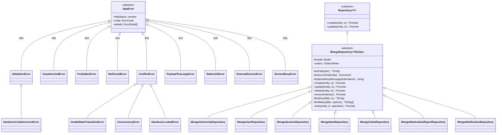
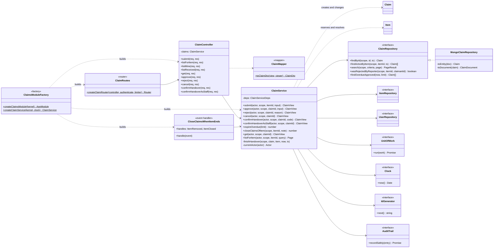
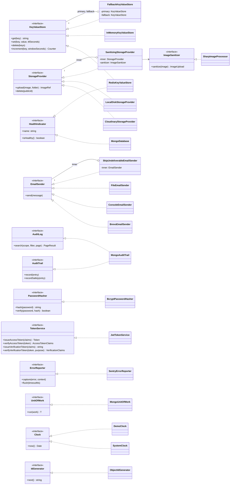
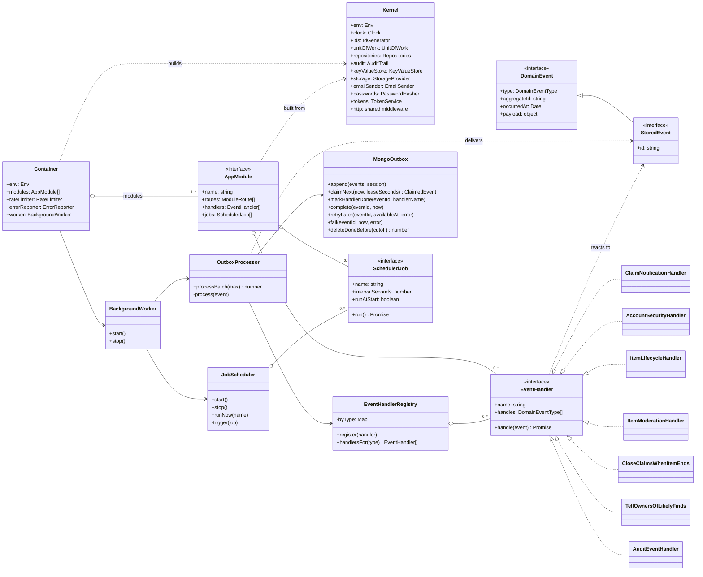

# Class Diagrams

Status: Built and live · Last updated: 27 October 2026

The classes of the API as they are in the code: the domain model with every entity, value object and relationship; the inheritance hierarchies; one module's layers from route to database; the interfaces with their implementations; and how events reach their handlers. Names match the source files under `apps/api/src`, so each box can be looked up.

**Notation** (UML, drawn with Mermaid):

| Arrow       | Meaning                                                                                      |
| ----------- | -------------------------------------------------------------------------------------------- |
| `A <\|-- B` | **Inheritance**: B extends A                                                                 |
| `A <\|.. B` | **Realisation**: B implements interface A                                                    |
| `A *-- B`   | **Composition**: B is part of A and is saved, loaded and deleted with it (an embedded value) |
| `A o-- B`   | **Aggregation**: A groups B, but B has a life of its own                                     |
| `A --> B`   | **Association**: A refers to B (by its id, across aggregates)                                |
| `A ..> B`   | **Dependency**: A uses B in a method                                                         |

Visibility: `+` public, `-` private, `#` protected. A `$` after a method marks it static (a factory), `*` abstract. Numbers on a line are multiplicities: `1`, `0..1`, `0..*`, `1..3`.

---

## 1. Domain model

The business rules live here. Seven **aggregates** (each loaded and saved as a unit, with its own version) extend `AggregateRoot`. Aggregates refer to each other **by id only**, never by holding the other object, so each one can be saved in its own transaction and checked for concurrent changes on its own; that is why the links between aggregates are associations, and the links to embedded values are compositions.

```mermaid
classDiagram
    direction TB

    class AggregateRoot {
        <<abstract>>
        +id: string
        -currentVersion: number
        -pendingEvents: DomainEvent[]
        +version: number
        +isNew: boolean
        #record(event) void
        +peekEvents() DomainEvent[]
        +pullEvents() DomainEvent[]
        +clearEvents() void
        +markPersisted(version) void
    }

    class University {
        +name: string
        +slug: string
        +emailDomains: string[]
        +schools: string[]
        +places: string[]
        +status: UniversityStatus
        +create(input)$ University
        +allowsEmail(email) boolean
        +ownsEmailDomain(email) boolean
        +hasSchool(school) boolean
        +hasPlace(place) boolean
        +updateSettings(settings, now) boolean
    }

    class User {
        +universityId: string
        +email: string
        -passwordHash: string
        +profile: UserProfile
        +role: Role
        +status: UserStatus
        +isActive: boolean
        +isDemo: boolean
        +register(input)$ User
        +assertEditable() void
        +updateProfile(changes, now) void
        +changeAvatar(avatar, now) ImageRef
        +removeAvatar(now) ImageRef
        +changePassword(hash, now, via) void
        +changeRole(role, by, now) void
        +appointBySystem(role, now) void
        +suspend(reason, by, now) void
        +reactivate(by, now) void
        +close(now) ImageRef
        -assertManageableBy(actor) void
    }

    class UserProfile {
        <<value object>>
        +firstName: string
        +lastName: string
        +year: number
        +school: string
        +enrollmentNumber: string
        +phone: string
        +avatar: ImageRef
    }

    class Session {
        +userId: string
        +familyId: string
        +tokenHash: string
        +expiresAt: Date
        +endedAt: Date
        +endReason: SessionEndReason
        +replacedById: string
        +isEnded: boolean
        +start(input)$ Session
        +isExpired(now) boolean
        +wasRotatedWithin(seconds, now) boolean
        +rotateTo(next, now) void
        +end(reason, now) void
    }

    class Item {
        +universityId: string
        +reporterId: string
        +type: ItemType
        +category: ItemCategory
        +title: string
        +description: string
        +location: string
        +place: string
        +occurredOn: Date
        +heldAtSecurityDesk: boolean
        +status: ItemStatus
        +closeReason: ItemCloseReason
        +expiresAt: Date
        +expiryRemindedAt: Date
        +resolvedAt: Date
        +isAcceptingClaims: boolean
        +report(input)$ Item
        +isReportedBy(userId) boolean
        +edit(actor, changes, now) void
        +reserve(now) void
        +reopen(now) void
        +resolve(now) void
        +close(actor, reason, now) void
        +keepOpen(actor, now) void
        +remindOfExpiry(now) boolean
        +expire(now) boolean
        +remove(actor, now, reason) void
        +releasePhotos() ImageRef[]
        -requireStatus(expected, action) void
    }

    class VerificationQuestion {
        <<value object>>
        +id: string
        +question: string
    }

    class ImageRef {
        <<value object>>
        +url: string
        +publicId: string
    }

    class Claim {
        +universityId: string
        +itemId: string
        +reporterId: string
        +claimantId: string
        +kind: ClaimKind
        +message: string
        +status: ClaimStatus
        +rejectionReason: string
        +claimantSharesPhone: boolean
        +reporterSharesPhone: boolean
        -state: ClaimState
        +ownerId: string
        +finderId: string
        +isActive: boolean
        +submit(input)$ Claim
        +isParty(userId) boolean
        +approve(actor, handover, now, placement) void
        +reject(actor, reason, now, placement) void
        +rejectAutomatically(reason, now) void
        +cancel(actor, now) void
        +cancelAutomatically(reason, now) void
        +completeHandover(actor, code, now) HandoverResult
        +completeHandoverAsStaff(actor, now) void
        +expire(now) void
        -requireDecider(actor, placement, action) void
        -transitionTo(status, by, now, note) void
    }

    class Handover {
        <<value object>>
        +code: string
        +deadline: Date
        +failedAttempts: number
    }

    class ClaimAnswer {
        <<value object>>
        +questionId: string
        +answer: string
    }

    class ClaimHistoryEntry {
        <<value object>>
        +from: ClaimStatus
        +to: ClaimStatus
        +byUserId: string
        +at: Date
        +note: string
    }

    class ClaimState {
        <<abstract>>
        +status: ClaimStatus
        +isActive: boolean
        +approve() ClaimStatus
        +reject() ClaimStatus
        +cancel() ClaimStatus
        +completeHandover() ClaimStatus
        +expire() ClaimStatus
    }
    class RequestedState
    class ApprovedState
    class TerminalState

    class ModerationReport {
        +universityId: string
        +itemId: string
        +flaggedBy: string
        +reason: ReportReason
        +details: string
        +status: ReportStatus
        +resolvedBy: string
        +resolvedAt: Date
        +resolutionNote: string
        +file(input)$ ModerationReport
        +resolve(decision, by, note, now) void
    }

    class Notification {
        +userId: string
        +universityId: string
        +type: NotificationType
        +title: string
        +body: string
        +claimId: string
        +itemId: string
        +sourceEventId: string
        +readAt: Date
        +emailedAt: Date
        +isRead: boolean
        +create(input)$ Notification
    }

    class RolePolicy {
        <<policy>>
        +canManage(actor, target) boolean
        +canAssign(actor, role) boolean
    }

    class Actor {
        <<interface>>
        +userId: string
        +role: Role
    }

    AggregateRoot <|-- University
    AggregateRoot <|-- User
    AggregateRoot <|-- Session
    AggregateRoot <|-- Item
    AggregateRoot <|-- Claim
    AggregateRoot <|-- ModerationReport
    AggregateRoot <|-- Notification

    User "1" *-- "1" UserProfile : profile
    UserProfile "1" *-- "0..1" ImageRef : avatar
    Item "1" *-- "1..3" ImageRef : images
    Item "1" *-- "0..3" VerificationQuestion : questions
    Claim "1" *-- "0..1" Handover : handover
    Claim "1" *-- "0..3" ClaimAnswer : answers
    Claim "1" *-- "1..*" ClaimHistoryEntry : history

    University "1" o-- "0..*" User : members
    University "1" o-- "0..*" Item : posts
    User "1" --> "0..*" Session : signed in on
    Session "0..1" --> "0..1" Session : replacedBy
    User "1" --> "0..*" Item : reports
    User "1" --> "0..*" Claim : submits as claimant
    Item "1" --> "0..*" Claim : receives
    Claim "0..*" --> "1" User : reporter
    Item "1" --> "0..*" ModerationReport : flagged in
    User "1" --> "0..*" ModerationReport : flags
    User "1" --> "0..*" Notification : receives
    Notification "0..*" --> "0..1" Claim : about
    Notification "0..*" --> "0..1" Item : about
    ClaimAnswer "0..*" --> "1" VerificationQuestion : answers

    Claim "0..*" --> "1" ClaimState : current state
    ClaimState <|-- RequestedState
    ClaimState <|-- ApprovedState
    ClaimState <|-- TerminalState

    User ..> RolePolicy : asks
    Claim ..> Item : checked on submit
    User ..> Actor : acted on by
    Claim ..> Actor : acted on by
    Item ..> Actor : acted on by
```

**Reading it**

- **Encapsulation:** every aggregate keeps its fields in a private `props` object and exposes read-only getters; constructors are private, so an object is only created through its named factory (`Item.report`, `Claim.submit`, `User.register`, `Session.start`, `ModerationReport.file`, `Notification.create`, `University.create`) or rebuilt by a repository with `restore`. Every change goes through a method that checks its rule first (for example `Item.reserve` only from `OPEN`; `Claim.approve` only by the reporter, or desk staff for an item held at the desk).
- **Composition** is exactly what is embedded in the aggregate's document ([database.md](database.md)): a claim's handover, answers and history; an item's photos and questions; a user's profile and picture. They have no id or life of their own.
- **Aggregation:** a university groups its members and posts, but users and items are aggregates of their own, saved separately.
- **`Claim` → `ClaimState`:** each claim has exactly one current state object. The six statuses share three state classes (`TerminalState` serves `REJECTED`, `CANCELLED`, `EXPIRED` and `COMPLETED`) and one instance per status (Flyweight, `claimStateFor`). The claim's state machine is drawn in [interactions.md](interactions.md#s1-claim).
- **`Actor`** is the signed-in person as the domain sees them (`userId`, `role`). Methods that need permission take it as a parameter, so rules are tested without HTTP.
- **Matching** has no class: `matchScore(lost, found)` in `modules/matching/domain/matchScore.ts` is a pure function over two posts (see [backend.md §8](../architecture/backend.md#8-matching)).

**Enumerations** (all in `packages/shared`, shared by API and web app):

```mermaid
classDiagram
    direction LR
    class Role {
        <<enumeration>>
        STUDENT
        SECURITY_DESK
        UNIVERSITY_ADMIN
        PLATFORM_ADMIN
    }
    class UserStatus {
        <<enumeration>>
        ACTIVE
        SUSPENDED
    }
    class ItemType {
        <<enumeration>>
        LOST
        FOUND
    }
    class ItemStatus {
        <<enumeration>>
        OPEN
        RESERVED
        RESOLVED
        CLOSED
        REMOVED
    }
    class ItemCloseReason {
        <<enumeration>>
        RETURNED
        WITHDRAWN
        EXPIRED
    }
    class ItemCategory {
        <<enumeration>>
        ELECTRONICS
        ID_CARD
        KEYS
        WALLET
        BAG
        CLOTHING
        BOOKS
        BOTTLE
        ACCESSORIES
        OTHER
    }
    class ClaimKind {
        <<enumeration>>
        OWNERSHIP
        FINDER
    }
    class ClaimStatus {
        <<enumeration>>
        REQUESTED
        APPROVED
        REJECTED
        CANCELLED
        EXPIRED
        COMPLETED
    }
    class ReportReason {
        <<enumeration>>
        SPAM
        INAPPROPRIATE
        SCAM
        DUPLICATE
        OTHER
    }
    class ReportStatus {
        <<enumeration>>
        OPEN
        DISMISSED
        ACTIONED
    }
    class SessionEndReason {
        <<enumeration>>
        ROTATED
        LOGOUT
        REUSE_DETECTED
        PASSWORD_CHANGED
        ACCOUNT_INACTIVE
    }
```

---

## 2. Inheritance hierarchies

Four places where a base class holds what its subclasses share.

- **`AppError`**: every error the API reports on purpose. `httpStatus` and `code` are abstract; each subclass fixes its HTTP status and error code, so the one error handler treats them all the same way (polymorphism) and anything that is not an `AppError` becomes a hidden 500 ([backend.md §11](../architecture/backend.md#11-error-handling)).
- **`MongoRepository`** (Template Method): the base class writes the algorithm once: insert with version 1, update only if the version still matches (else `ConcurrencyError`), store the aggregate's events in the outbox in the same transaction, turn a duplicate-key error into a `ConflictError`. Subclasses fill in only the mapping (`toEntity`, `toDocument`) and their queries.
- **`AggregateRoot`** and **`ClaimState`** are in the domain model above.

---

## 3. One module's layers: claims

Every business module has the same shape. Dependencies point inwards: the controller knows the service, the service knows the domain and the repository **interface**, and only the infrastructure class knows MongoDB. The module factory builds it all from the kernel.

| Layer          | Class                                       | Its one job                                                                                                     |
| -------------- | ------------------------------------------- | --------------------------------------------------------------------------------------------------------------- |
| Route          | `createClaimRouter`                         | URL and method → middleware (authenticate, rate limit, validate with Zod) → controller method                   |
| Controller     | `ClaimController`                           | Read the validated request, call one service method, answer with the mapper's DTO and status code               |
| Mapper         | `toClaimDto`                                | Decide what each viewer may see (contact details only for the two people, the code only for the owner)          |
| Service        | `ClaimService`                              | One method per use case: load, call the domain, save, inside a transaction where several writes belong together |
| Domain         | `Claim`, `ClaimState`, `Item`               | The rules, with no framework imports                                                                            |
| Repository     | `ClaimRepository` (interface, in `domain/`) | What the service needs from storage, in business words                                                          |
| Infrastructure | `MongoClaimRepository`                      | Schema, indexes, document ↔ entity mapping                                                                      |
| Event handler  | `CloseClaimsWhenItemEnds`                   | Reacts to another module's events, so the items module never calls the claims module                            |

The other business modules (auth, users, items, matching, moderation, notifications) follow the same pattern; the folder layout is in [backend.md §3](../architecture/backend.md#3-repository-and-folder-structure).

---

## 4. Interfaces and their implementations

Services depend only on these interfaces (in `core/`, or a module's `domain/`). The composition root (`container.ts`) chooses an implementation once, from configuration. Several implementations of one interface are interchangeable, and two of them wrap another implementation of the same interface (Decorator).

- **Decorators:** `FallbackKeyValueStore` wraps Redis and switches to memory while Redis is down (a small circuit breaker); `SanitizingStorageProvider` re-encodes every photo before any storage provider sees it; `SkipUndeliverableEmailSender` drops mail to reserved test domains (the demo accounts) before it reaches Brevo. Callers can't tell a decorated provider from a plain one.
- **Interface segregation:** `MongoAuditTrail` implements two small interfaces: `AuditTrail` (write) for the services and event handlers, `AuditLog` (read) for the admin screen; no service that writes the log can read it. `RedisKeyValueStore` is also a `HealthIndicator`, but the services that use it as a store never see that side.
- **Test doubles** implement the same interfaces: `FixedClock`, `InMemoryStorageProvider`, `CapturingEmailSender`, `RecordingErrorReporter`, `FakeHealthIndicator` (in `src/testing/` and the tests).

---

## 5. Events, handlers and jobs

How modules plug in, and how a change in one module reaches the others without a direct call.

- **Observer:** an aggregate records events while its methods run; the repository saves them with the change; the `OutboxProcessor` hands each one to every handler registered for its type. The module that raised an event never knows who reacts.
- **Event catalogue:** the 20 event types and their payloads are defined once in `modules/events.ts`; `handles` is checked against it at compile time ([ADR 0012](../adr/0012-self-wiring-modules-and-event-contracts.md)).
- **Jobs:** each module returns its scheduled jobs (`expire-claims`, `close-stale-posts`, `purge-removed-item-photos`, `prune-outbox`, `reset-demo-data`); the scheduler runs each on one instance at a time using a lease in Redis.
