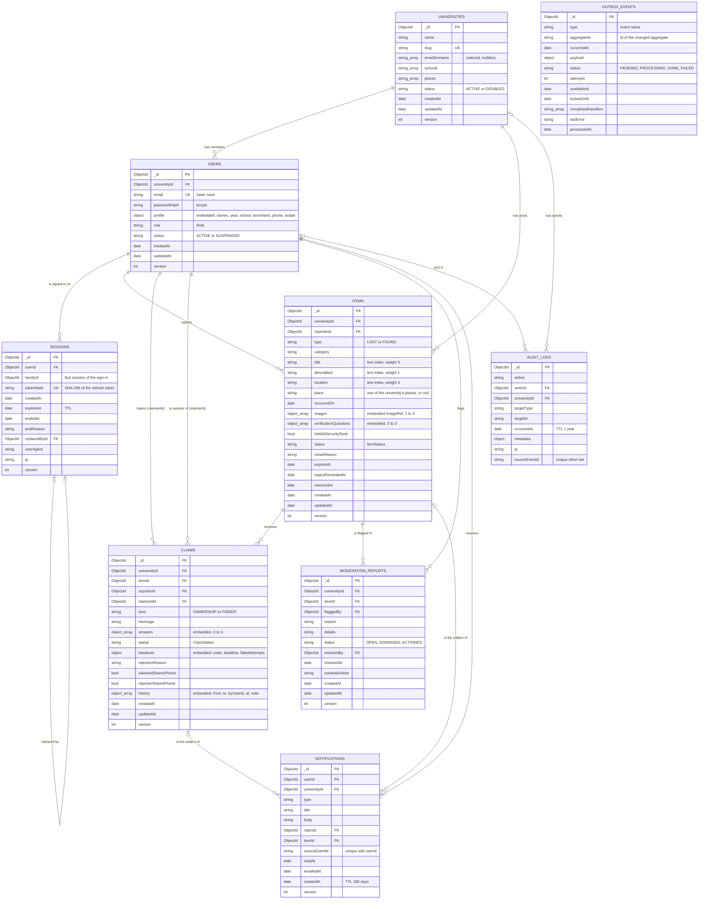

# Database Schema

Status: Built and live · Last updated: 27 October 2026

How the classes of [class-diagrams.md](class-diagrams.md) are stored: the MongoDB collections with their fields, keys, relationships and indexes, why each part is embedded or referenced, how consistency is kept without foreign keys, and what lives in Redis. Why MongoDB and not a relational database is in [ADR 0005](../adr/0005-mongodb-with-transactions.md).

Database: MongoDB 8.0 (Atlas), one replica set, so multi-document transactions work. Each schema is defined next to its repository (`modules/*/infrastructure/Mongo*Repository.ts`, plus `MongoOutbox` and `MongoAuditTrail`).

---

## 1. From classes to collections

**The rule: one aggregate, one document.** Each aggregate of the domain model is one document in its own collection; everything the aggregate is **composed of** is embedded in that document; other aggregates are **referenced by id**.

| Class (aggregate)  | Collection           | Embedded (composition)                                                 | Referenced by id (association)                                           |
| ------------------ | -------------------- | ---------------------------------------------------------------------- | ------------------------------------------------------------------------ |
| `University`       | `universities`       | `emailDomains`, `schools`, `places` (lists of strings)                 | none                                                                     |
| `User`             | `users`              | `profile` (`UserProfile`), `profile.avatar` (`ImageRef`)               | `universityId`                                                           |
| `Session`          | `sessions`           | none                                                                   | `userId`, `familyId`, `replacedById`                                     |
| `Item`             | `items`              | `images` (1 to 3 `ImageRef`), `verificationQuestions` (0 to 3)         | `universityId`, `reporterId`                                             |
| `Claim`            | `claims`             | `answers` (0 to 3), `handover` (0 or 1), `history` (1 or more entries) | `universityId`, `itemId`, `reporterId`, `claimantId`, `history.byUserId` |
| `ModerationReport` | `moderation_reports` | none                                                                   | `universityId`, `itemId`, `flaggedBy`, `resolvedBy`                      |
| `Notification`     | `notifications`      | none                                                                   | `userId`, `universityId`, `claimId`, `itemId`                            |
| domain events      | `outbox_events`      | `payload`                                                              | `aggregateId` (any aggregate)                                            |
| audit entries      | `audit_logs`         | `metadata`                                                             | `universityId`, `actorId`, `targetId`                                    |

**Why embed:** the embedded parts are always read and changed together with their aggregate, have no meaning on their own, and are small and bounded (at most 3 photos, 3 questions, 3 answers; a claim's history has a handful of entries). Embedding makes loading an aggregate one read, and changing it one atomic write.

**Why reference:** aggregates change independently and by different people (a claimant and a reporter edit different documents). Each keeps its own `version`, so a referenced aggregate is never overwritten by a save of another. Copying data across aggregates would need updating everywhere; the only copy is the item's `reporterId` on the claim, which never changes after the item is posted, so it can't go stale and saves a join on every claim list.

**Denormalised on purpose:** `universityId` is stored on every tenant-owned document (users, items, claims, reports, notifications, audit entries), so every query starts with the tenant and every index can lead with it. The repository methods require a `TenantScope`, so a query without it can't be written.

---

## 2. Entity relationship diagram

`PK` primary key, `FK` a reference to another collection, `UK` unique. Crow's feet show multiplicity: `||` exactly one, `|o` zero or one, `o{` zero or more.

---

## 3. Collections, keys and indexes

Every index is named, and each one serves a query in the code; they are created at start-up (`ensureIndexes`), not implicitly. The `_id` index every collection has is not listed.

### `universities`

| Index             | Fields         | Options | Serves                                                                                                    |
| ----------------- | -------------- | ------- | --------------------------------------------------------------------------------------------------------- |
| `uniq_slug`       | `slug`         | unique  | One record per university; the seed script updates it by slug                                             |
| `by_email_domain` | `emailDomains` |         | Finding the university of an email address at sign-up (each subdomain level is tried: `a.b.edu`, `b.edu`) |

### `users`

| Index                  | Fields                             | Options | Serves                                                                   |
| ---------------------- | ---------------------------------- | ------- | ------------------------------------------------------------------------ |
| `uniq_email`           | `email`                            | unique  | Sign-in and sign-up lookups; one account per address across the platform |
| `by_university_role`   | `universityId, role`               |         | People by role (statistics, the admin's role filter)                     |
| `by_university_newest` | `universityId, createdAt ↓, _id ↓` |         | The admin's People list, newest first, page by page                      |

### `sessions`

| Index             | Fields            | Options          | Serves                                                           |
| ----------------- | ----------------- | ---------------- | ---------------------------------------------------------------- |
| `uniq_token_hash` | `tokenHash`       | unique           | Finding the session of a refresh token (only the hash is stored) |
| `by_family`       | `familyId`        |                  | Ending a whole sign-in's sessions (sign-out, theft detected)     |
| `by_user`         | `userId, endedAt` |                  | Ending every session of a user (password change, suspension)     |
| `ttl_expires_at`  | `expiresAt`       | TTL, at the date | MongoDB deletes sessions once they expire                        |

### `items`

| Index         | Fields                                           | Options         | Serves                                                                   |
| ------------- | ------------------------------------------------ | --------------- | ------------------------------------------------------------------------ |
| `feed`        | `universityId, status, type, createdAt ↓, _id ↓` |                 | The browse feed and its tabs, with cursor paging on (`createdAt`, `_id`) |
| `by_reporter` | `universityId, reporterId, createdAt ↓`          |                 | "My items"                                                               |
| `by_expiry`   | `status, expiresAt`                              |                 | The hourly job that reminds reporters and closes stale posts             |
| `text_search` | `title`, `location`, `description` (text)        | weights 5, 3, 1 | Word search with English stemming ("keys" finds "key")                   |

### `claims`

| Index                            | Fields                                     | Options                                            | Serves                                                                                |
| -------------------------------- | ------------------------------------------ | -------------------------------------------------- | ------------------------------------------------------------------------------------- |
| `by_item`                        | `universityId, itemId, createdAt`          |                                                    | Claims on one post; active claims to decline when a handover completes                |
| `by_claimant`                    | `universityId, claimantId, createdAt ↓`    |                                                    | "Claims I made"                                                                       |
| `by_reporter`                    | `universityId, reporterId, createdAt ↓`    |                                                    | "Claims on my posts"                                                                  |
| `by_status`                      | `universityId, status, createdAt ↓, _id ↓` |                                                    | The security desk's handovers waiting                                                 |
| `overdue`                        | `status, handover.deadline`                |                                                    | The job that expires approved claims past their deadline                              |
| `uniq_active_claim_per_claimant` | `itemId, claimantId`                       | unique where `status` is `REQUESTED` or `APPROVED` | **At most one active claim per person per item**, even if two requests arrive at once |
| `uniq_approved_claim_per_item`   | `itemId`                                   | unique where `status` is `APPROVED`                | **At most one approved claim per item**, even if two approvals race                   |

### `moderation_reports`

| Index               | Fields                                     | Options | Serves                                                             |
| ------------------- | ------------------------------------------ | ------- | ------------------------------------------------------------------ |
| `uniq_item_flagger` | `itemId, flaggedBy`                        | unique  | **One report per person per post** (nobody piles up reports alone) |
| `review_queue`      | `universityId, status, createdAt ↓, _id ↓` |         | The admin's review queue, open or decided                          |

### `notifications`

| Index                  | Fields                       | Options       | Serves                                                                          |
| ---------------------- | ---------------------------- | ------------- | ------------------------------------------------------------------------------- |
| `by_user`              | `userId, createdAt ↓, _id ↓` |               | The notification list, newest first                                             |
| `unread_by_user`       | `userId, readAt`             |               | The unread count on the bell; marking all as read                               |
| `uniq_event_recipient` | `sourceEventId, userId`      | unique        | **Idempotent handlers**: a redelivered event can't notify the same person twice |
| `ttl_created_at`       | `createdAt`                  | TTL, 180 days | Old notifications are deleted automatically                                     |

### `outbox_events`

| Index       | Fields                | Serves                                                    |
| ----------- | --------------------- | --------------------------------------------------------- |
| `ready`     | `status, availableAt` | The worker taking the next due event                      |
| `abandoned` | `status, lockedUntil` | Taking over an event whose worker crashed (lease ran out) |
| `processed` | `status, processedAt` | The daily job deleting delivered events older than 7 days |

### `audit_logs`

| Index               | Fields                               | Options                     | Serves                                                         |
| ------------------- | ------------------------------------ | --------------------------- | -------------------------------------------------------------- |
| `by_university`     | `universityId, occurredAt ↓, _id ↓`  |                             | The admin's activity log, page by page, filtered by time       |
| `by_actor`          | `actorId, occurredAt ↓`              |                             | "View activity" of one person                                  |
| `by_target`         | `targetType, targetId, occurredAt ↓` |                             | The history of one record                                      |
| `uniq_source_event` | `sourceEventId`                      | unique where it is a string | One entry per event, so a redelivered event isn't logged twice |
| `ttl`               | `occurredAt`                         | TTL, 1 year                 | Entries are deleted after a year                               |

---

## 4. Keeping the data consistent

MongoDB has no foreign keys and no cascades, so the code keeps the references sound. Each mechanism and what it protects:

| Mechanism                          | Where                                                     | Protects against                                                                                                                                                          |
| ---------------------------------- | --------------------------------------------------------- | ------------------------------------------------------------------------------------------------------------------------------------------------------------------------- |
| **Strict schemas**                 | `collectionOptions`: `strict: 'throw'`; enums; `required` | Unknown fields and values outside an enum are refused on write, also in embedded documents                                                                                |
| **Transactions** (Unit of Work)    | `MongoUnitOfWork.run`                                     | Half-done changes: approving a claim and reserving its item, completing a handover and declining the other claims, removing a post and closing its reports                |
| **Optimistic versions**            | `version` on every aggregate; `MongoRepository.update`    | Lost updates: a save only matches the version that was loaded, otherwise `ConcurrencyError` (409)                                                                         |
| **Unique and partial indexes**     | the `uniq_*` indexes above                                | Races the code alone can't stop: two claims at once, two approvals at once, a duplicate report, a duplicate notification or log entry                                     |
| **Outbox in the same transaction** | `MongoRepository.write`                                   | An event without its change, or a change without its event                                                                                                                |
| **Events instead of cascades**     | `CloseClaimsWhenItemEnds`, the notification handlers      | A removed or closed post leaving active claims behind                                                                                                                     |
| **Account deletion in steps**      | `AccountService`                                          | Dangling personal data: open posts removed, active claims cancelled, sessions, notifications and picture deleted; finished handovers keep the id and show "Former member" |
| **Soft delete**                    | item status `REMOVED`                                     | Losing evidence a moderator may need; photos are deleted 30 days later by a job                                                                                           |

Timestamps (`createdAt`, `updatedAt`) are set by the domain from the injected `Clock`, not by Mongoose, so tests can move time and every document of one action carries the same moment.

---

## 5. Retention

| Data                            | Kept                       | How                                                     |
| ------------------------------- | -------------------------- | ------------------------------------------------------- |
| Sessions                        | until they expire (7 days) | TTL index                                               |
| Notifications                   | 180 days                   | TTL index                                               |
| Audit log                       | 1 year                     | TTL index                                               |
| Delivered outbox events         | 7 days                     | daily job `prune-outbox`                                |
| Photos of removed posts         | 30 days                    | hourly job `purge-removed-item-photos`                  |
| Open posts                      | 60 days unless kept open   | hourly job `close-stale-posts` (closed, not deleted)    |
| Everything of a deleted account | removed at once            | `DELETE /account` (finished handovers stay, anonymised) |

---

## 6. Redis (short-lived data)

Redis (Upstash) holds only counters and codes that expire by themselves; nothing in it needs a backup. If Redis is down, `FallbackKeyValueStore` keeps the same keys in the API's memory until it is back.

| Key                                                     | Holds                                                                                | Expires            |
| ------------------------------------------------------- | ------------------------------------------------------------------------------------ | ------------------ |
| `otp:{purpose}:{email}`                                 | HMAC of the current sign-up or reset code                                            | 10 minutes         |
| `otp-attempts:{purpose}:{email}`                        | Guesses at the current code (5 allowed)                                              | 10 minutes         |
| `otp-cooldown:{purpose}:{email}`                        | One new code per minute                                                              | 1 minute           |
| `otp-failures:{purpose}:{email}`                        | Wrong codes today (10 allowed)                                                       | 1 day              |
| `login-failures:{email}:{ip}`, `login-failures:{email}` | Failed sign-ins (10 per 15 minutes per account and address; 50 per hour per account) | 15 minutes, 1 hour |
| `ratelimit:{rule}:{subject}`                            | Requests per rule, per user, email or IP                                             | the rule's window  |
| `job-lease:{job}`                                       | Which instance runs a scheduled job this interval                                    | the job's interval |
