# Sequence, Activity and State Diagrams

Status: Built and live · Last updated: 27 October 2026

How control flows through the system for the core use cases of [requirements.md](requirements.md): which objects take part and in what order (sequence diagrams), the journeys from start to end with their decisions (activity diagrams), and the life of each object with a status (state diagrams). Participant names are the classes in [class-diagrams.md](class-diagrams.md).

Every request first passes the same middleware (request id, security headers, CORS, rate limits, authentication, Zod validation), drawn once in [A3](#a3-one-request-through-the-api) and left out of the sequence diagrams to keep them readable. A shaded box marks **one database transaction**: everything inside it commits together or not at all.

| Diagram                                                                      | Use case                            |
| ---------------------------------------------------------------------------- | ----------------------------------- |
| [Q1 Sign up](#q1-sign-up)                                                    | UC-1                                |
| [Q2 Sign in and refresh the session](#q2-sign-in-and-refresh-the-session)    | FR-2                                |
| [Q3 Report a found item, and matching](#q3-report-a-found-item-and-matching) | UC-2                                |
| [Q4 Claim an item](#q4-claim-an-item)                                        | UC-3                                |
| [Q5 Approve a claim](#q5-approve-a-claim)                                    | UC-4                                |
| [Q6 Hand over with the code](#q6-hand-over-with-the-code)                    | UC-5, UC-7                          |
| [Q7 Remove a reported post](#q7-remove-a-reported-post)                      | UC-6                                |
| [Q8 Delivering events (outbox)](#q8-delivering-events-outbox)                | all                                 |
| [A1 From lost to returned](#a1-from-lost-to-returned)                        | UC-2 to UC-5                        |
| [A2 Post lifecycle](#a2-post-lifecycle)                                      | FR-13, FR-14                        |
| [A3 One request through the API](#a3-one-request-through-the-api)            | all                                 |
| [S1 to S5 State diagrams](#state-diagrams)                                   | claim, item, report, session, event |

---

## Sequence diagrams

### Q1 Sign up

Three requests: ask for a code, prove it, create the account. The code is never stored, only its HMAC, and the answer to step 1 is the same whether or not the email has an account.

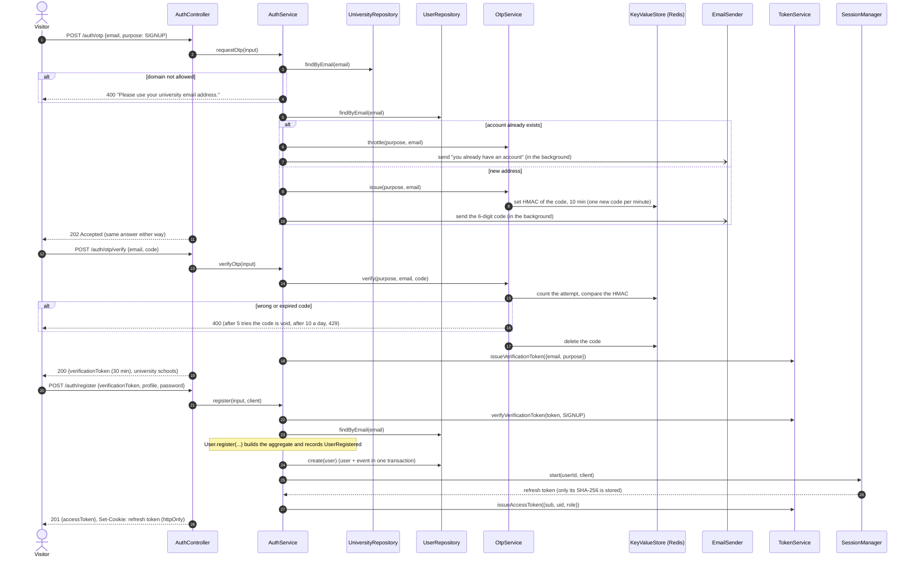

### Q2 Sign in and refresh the session

Access tokens last 15 minutes and live only in the page's memory; the refresh token is an `httpOnly` cookie and is **replaced on every use**. Presenting an already-replaced token again (after a 30-second grace window for racing tabs) means it was copied, so the whole family of sessions ends.

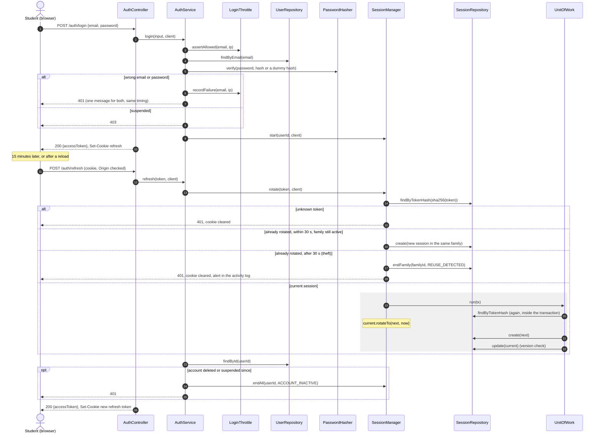

### Q3 Report a found item, and matching

The photos are checked and cleaned before they are stored, the post and its `ItemReported` event are saved together, and matching runs later in the background, so the student's request never waits for it.

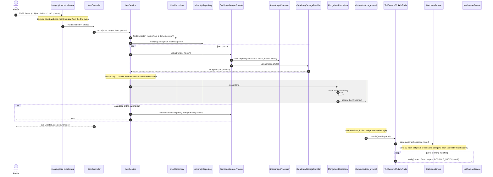

### Q4 Claim an item

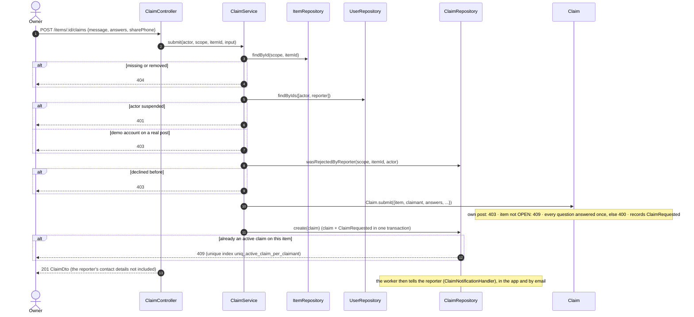

### Q5 Approve a claim

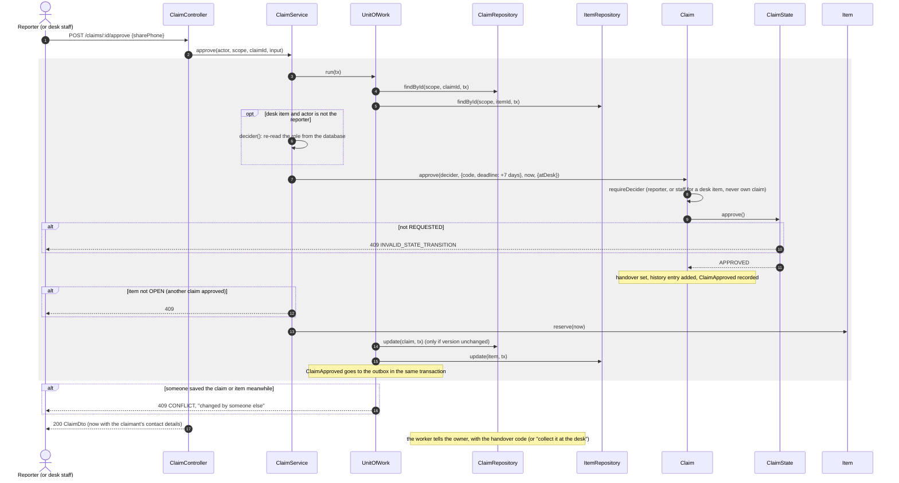

### Q6 Hand over with the code

A wrong code is **saved, not thrown**, inside the transaction, so a retry can't reset the count; the error is raised only after the commit.

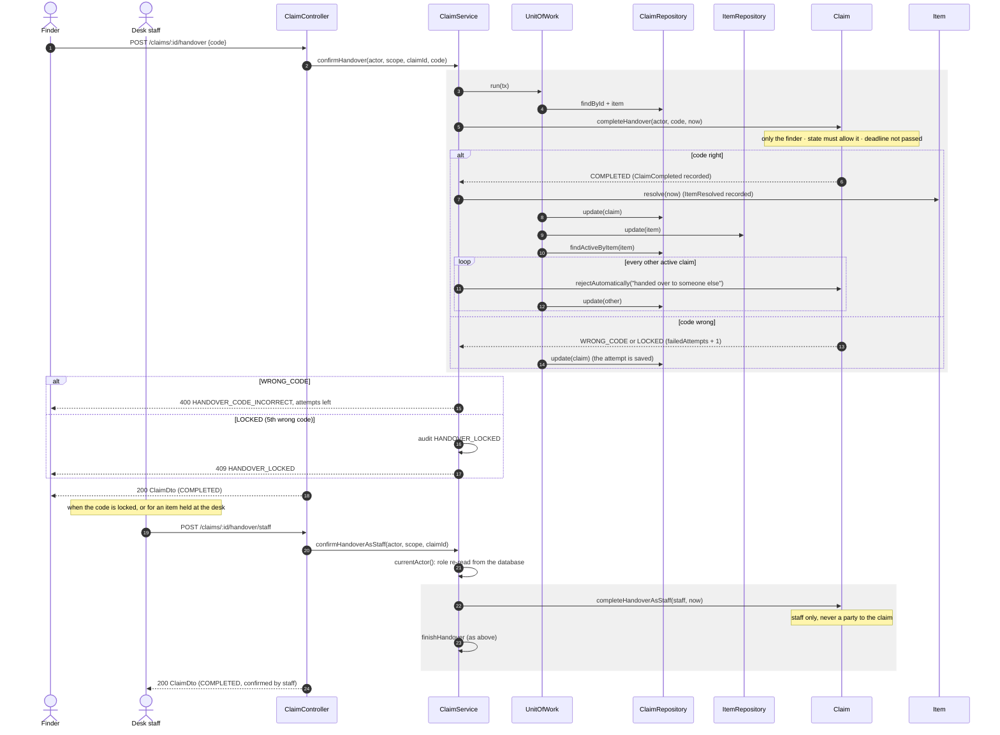

### Q7 Remove a reported post

The admin's decision changes the post and its reports in one transaction. Everything that follows (claims closed, poster told, activity logged) happens through events, so the moderation module calls no other module.

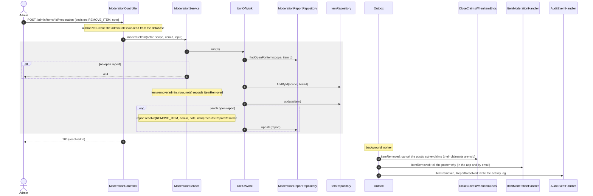

### Q8 Delivering events (outbox)

The background worker, in the API process or on its own. Delivery is **at least once**; handlers are written to be safe when repeated.

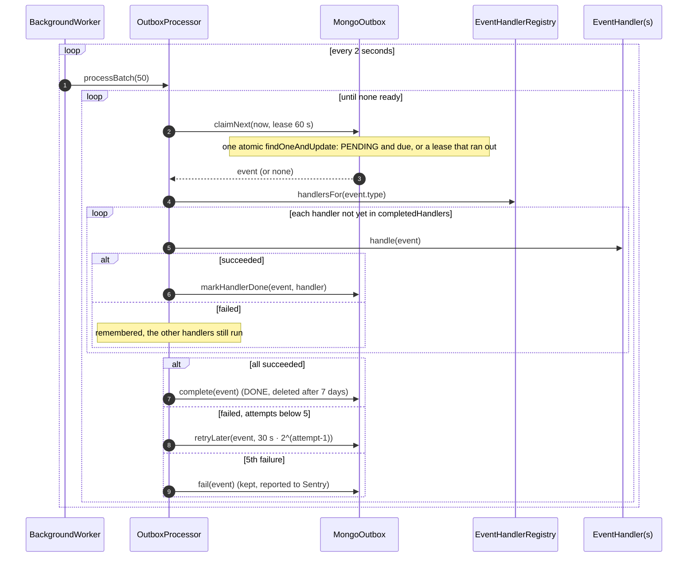

---

## Activity diagrams

### A1 From lost to returned

The whole journey, one lane per person and one for the system. Diamonds are decisions.

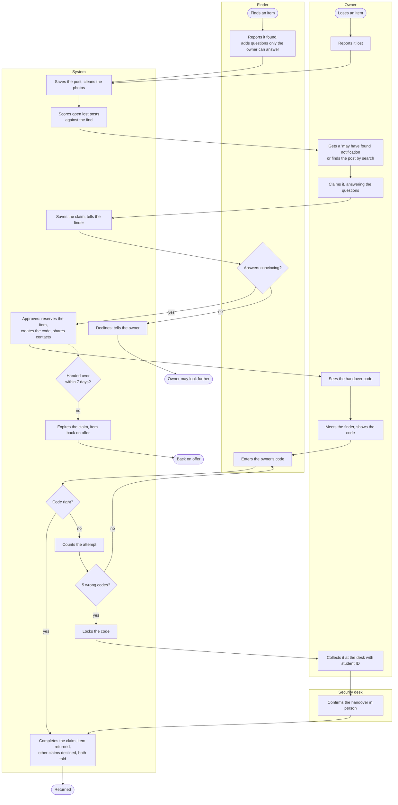

### A2 Post lifecycle

What happens to a post over time, including the hourly job that reminds and closes.

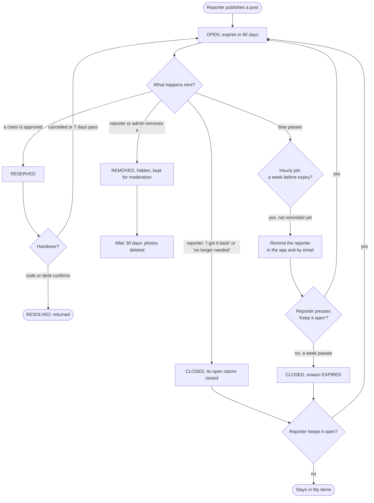

### A3 One request through the API

Every request takes this path; the error handler turns any failure into the same JSON format. This is where validation, rate limits and errors are handled once for the whole API.

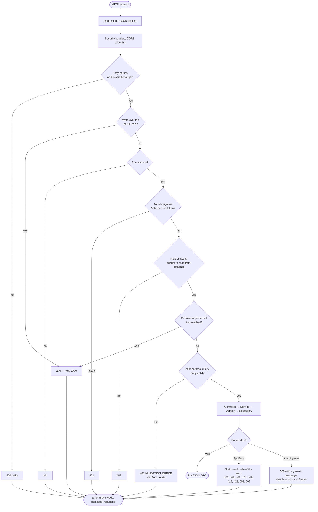

---

## State diagrams

### S1 Claim

Implemented with the State pattern (`ClaimState`): each state allows only the arrows leaving it, anything else is `InvalidStateTransitionError` (409).

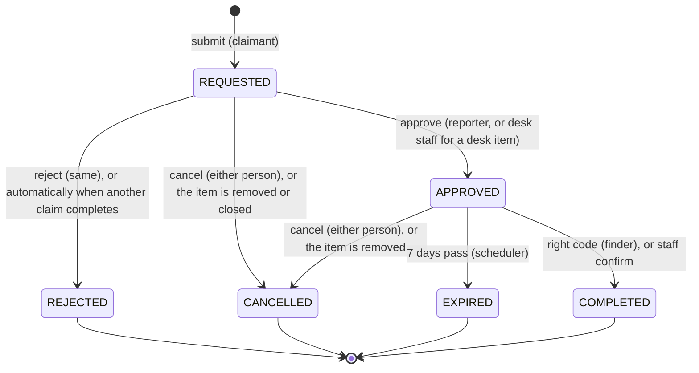

### S2 Item

Guarded by `Item` itself (`requireStatus`): edit, close and reserve only while `OPEN`, reopen and resolve only from `RESERVED`.

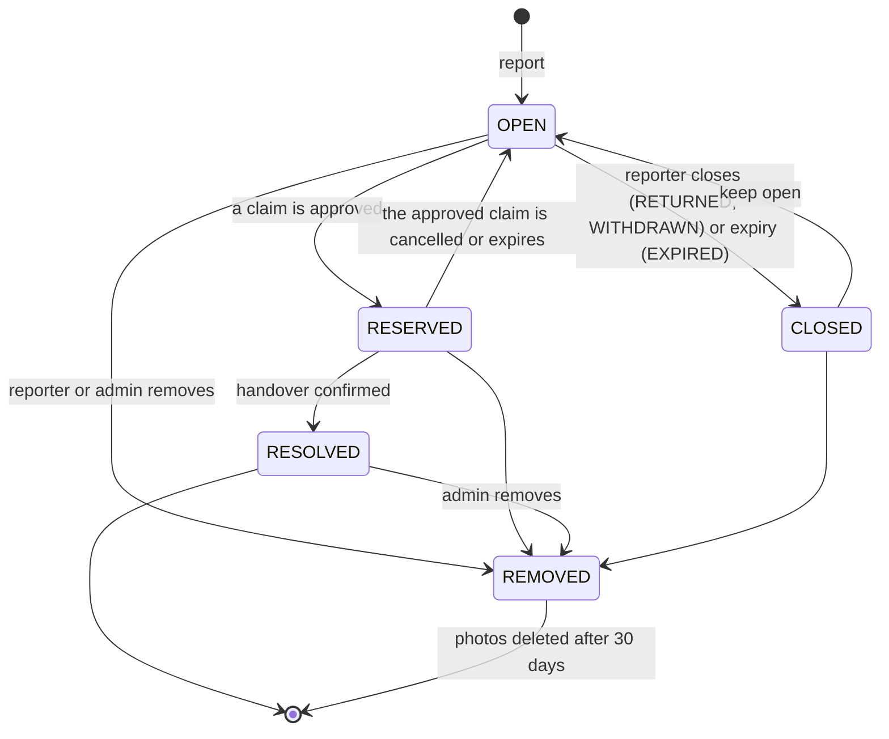

### S3 Moderation report

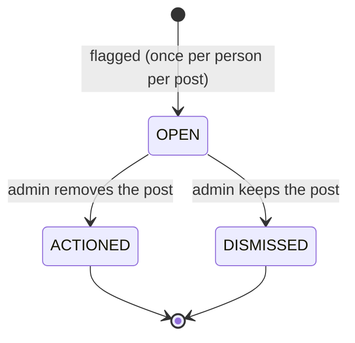

### S4 Session (refresh token)

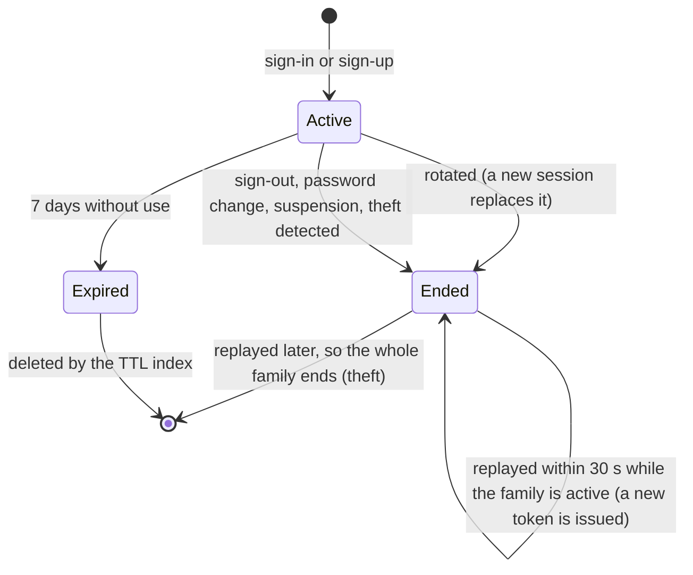

### S5 Outbox event

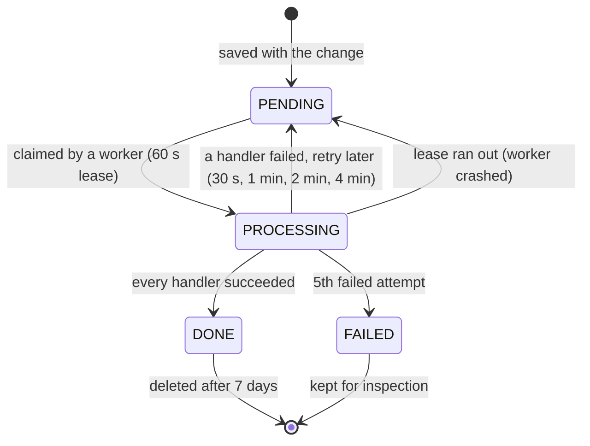
