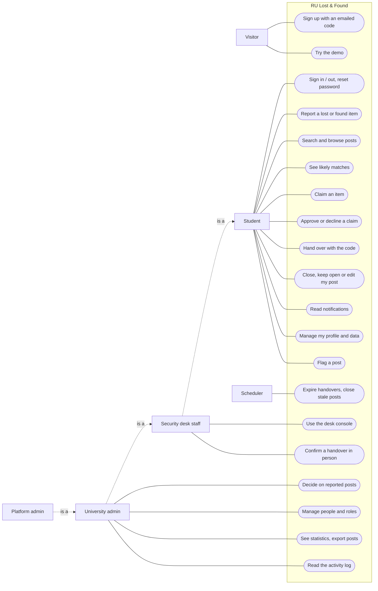

# Requirements

Status: Built and live · Last updated: 28 October 2026

What the portal must do (functional requirements), how well it must do it (non-functional requirements), who uses it (actors) and the core use cases step by step. Each requirement points to the module that implements it and the tests that prove it, so nothing here is a promise the code doesn't keep.

---

## 1. Problem and goal

Students of Rishihood University lose and find things on campus every day: phones, ID cards, keys, bottles. Before the portal, finds were posted in group chats and on notice boards, where they were buried within hours, anyone could say "that's mine", and students shared their phone numbers with strangers to arrange a return. Nobody kept a record of who received what.

**Goal:** one place where a lost or found item is reported, its owner proves it is theirs, and the return is confirmed, without sharing contact details with strangers and with a record of every step.

**Scope:** one university per deployment (Rishihood University today); the code is multi-tenant, so another organisation runs its own branded deployment by configuration ([ADR 0011](../adr/0011-branded-deployment-per-organisation.md)).

---

## 2. Actors

| Actor                   | Who                                                                                                                                                                        | Main goals                                                                                                     |
| ----------------------- | -------------------------------------------------------------------------------------------------------------------------------------------------------------------------- | -------------------------------------------------------------------------------------------------------------- |
| **Visitor**             | Anyone not signed in                                                                                                                                                       | Learn what the portal does, try it with a sample account, sign up                                              |
| **Student**             | A signed-in member of the university. One account plays every part: **reporter** of a post, **claimant** on someone else's post, and so **finder** or **owner** of an item | Report what they lost or found, find their item, prove it is theirs, hand an item back safely                  |
| **Security desk staff** | Campus security (role `SECURITY_DESK`). Everything a student can do, plus the desk                                                                                         | Keep track of items handed in, decide on claims for them as a team, confirm handovers in person                |
| **University admin**    | Staff running the portal (role `UNIVERSITY_ADMIN`). Everything the desk can do, plus administration                                                                        | Keep posts appropriate, manage people and roles, see how well items get back, export reports                   |
| **Platform admin**      | The deployment's owner (role `PLATFORM_ADMIN`, from the `ADMIN_EMAILS` setting). The highest rank                                                                          | Appoint university admins; the same tools as a university admin                                                |
| **Scheduler** (system)  | The background worker's clock                                                                                                                                              | Expire overdue handovers, remind and close stale posts, delete old photos and delivered events, reset the demo |
| **Email service**       | Brevo (external)                                                                                                                                                           | Deliver codes and notifications                                                                                |
| **Image storage**       | Cloudinary (external)                                                                                                                                                      | Store and serve photos                                                                                         |
| **Monitoring**          | Sentry and UptimeRobot (external)                                                                                                                                          | Receive error reports; ping the health check                                                                   |

The four human roles are ranked: `STUDENT` < `SECURITY_DESK` < `UNIVERSITY_ADMIN` < `PLATFORM_ADMIN` (`ROLE_RANK` in `packages/shared`). Each inherits what the one below it can do, which the use case diagram shows as generalisation.

---

## 3. Use case diagram

Mermaid has no use case notation, so actors are drawn as boxes, use cases as rounded shapes, and a dotted arrow between actors means "is a kind of" (generalisation).

---

## 4. Functional requirements

Numbered for reference. "Where" is the API module (under `apps/api/src/modules/`); "Proved by" names the test files (API tests sit next to the module; end-to-end tests are in `apps/web/e2e/`).

### Accounts

| #    | Requirement                                                                                                                                                                                            | Where              | Proved by                                                    |
| ---- | ------------------------------------------------------------------------------------------------------------------------------------------------------------------------------------------------------ | ------------------ | ------------------------------------------------------------ |
| FR-1 | A person signs up with an email address of an allowed domain: a 6-digit code sent to it proves the address, then they enter their name, year, school, enrolment number, optional phone and a password. | auth, universities | `auth.int.test.ts`, `journey.spec.ts`                        |
| FR-2 | A person signs in with email and password, stays signed in across reloads and visits (a session lasts 7 days from the last visit), and signs out of this device.                                       | auth               | `auth.int.test.ts`, `journey.spec.ts`                        |
| FR-3 | A person who forgot their password resets it with an emailed code; every device is then signed out.                                                                                                    | auth               | `auth.int.test.ts`                                           |
| FR-4 | A signed-in person changes their password by giving the current one; other devices are signed out, this one stays signed in.                                                                           | auth               | `auth.int.test.ts`, `account.spec.ts`                        |
| FR-5 | A person edits their profile and sets or removes a profile picture.                                                                                                                                    | users              | `user.service.test.ts`, `interface.spec.ts`                  |
| FR-6 | A person downloads all their data (profile, posts, claims made and received, notifications) as one file.                                                                                               | account            | `account.int.test.ts`, `account.spec.ts`                     |
| FR-7 | A person deletes their account after giving their password. Their open posts and active claims end (the other people are told); finished handovers stay, showing "Former member".                      | account            | `account.int.test.ts`, `account.spec.ts`                     |
| FR-8 | While the demo is on, a visitor signs in with one click as a sample student and tries a whole claim on sample posts, which reset every hour and never mix with real ones.                              | demo               | `demo.int.test.ts`, `demoSignIn.int.test.ts`, `demo.spec.ts` |

### Posts

| #     | Requirement                                                                                                                                                                                                                                                | Where | Proved by                                                |
| ----- | ---------------------------------------------------------------------------------------------------------------------------------------------------------------------------------------------------------------------------------------------------------- | ----- | -------------------------------------------------------- |
| FR-9  | A student reports a lost or found item with 1 to 3 photos, a category, a title, a description, a campus place and the exact spot, and the date. A found item may carry up to 3 verification questions and may be marked as handed in at the security desk. | items | `Item.test.ts`, `items.int.test.ts`, `journey.spec.ts`   |
| FR-10 | Students search posts by words and filter by lost or found, category and status (All, Lost, Found, Returned), with a count for each tab, newest first, page by page.                                                                                       | items | `items.int.test.ts`                                      |
| FR-11 | A student opens a post to see its photos and details.                                                                                                                                                                                                      | items | `items.int.test.ts`                                      |
| FR-12 | The reporter edits their post while it is open.                                                                                                                                                                                                            | items | `Item.test.ts`, `items.int.test.ts`                      |
| FR-13 | The reporter closes their open post ("I got it back" or "no longer needed"), keeps it open for another 60 days, or opens a closed post again.                                                                                                              | items | `Item.test.ts`, `items.int.test.ts`, `interface.spec.ts` |
| FR-14 | An open post closes by itself 60 days after it was posted (or last kept open), and only after its reporter was reminded a week before.                                                                                                                     | items | `Item.test.ts`, `items.int.test.ts`                      |
| FR-15 | The reporter or an admin removes a post. It disappears everywhere but is kept for moderation; its photos are deleted 30 days later.                                                                                                                        | items | `items.int.test.ts`, `admin-tools.spec.ts`               |

### Matching

| #     | Requirement                                                                                                                                                               | Where    | Proved by                                    |
| ----- | ------------------------------------------------------------------------------------------------------------------------------------------------------------------------- | -------- | -------------------------------------------- |
| FR-16 | The reporter of an open post sees up to 5 posts from the other side (lost for found, found for lost) that may be the same item, best first, marked as strong or possible. | matching | `matchScore.test.ts`, `matching.int.test.ts` |
| FR-17 | When a found item is reported, the owners of up to 3 strongly matching lost posts are told in the app and by email.                                                       | matching | `matching.int.test.ts`, `matching.spec.ts`   |

### Claims and handover

| #     | Requirement                                                                                                                                                                                                                                          | Where  | Proved by                                                |
| ----- | ---------------------------------------------------------------------------------------------------------------------------------------------------------------------------------------------------------------------------------------------------- | ------ | -------------------------------------------------------- |
| FR-18 | A student claims a found item as theirs by answering every verification question, or tells the reporter of a lost item that they found it. One active claim per person per item; never on their own post; not again once the reporter declined them. | claims | `Claim.test.ts`, `claims.int.test.ts`                    |
| FR-19 | The reporter approves a claim (only one per item at a time; the item is reserved and a 6-digit handover code goes to the item's owner, valid 7 days) or declines it with an optional reason.                                                         | claims | `Claim.test.ts`, `claims.int.test.ts`                    |
| FR-20 | Either person cancels a claim; cancelling an approved claim puts the item back on offer.                                                                                                                                                             | claims | `Claim.test.ts`, `claims.int.test.ts`                    |
| FR-21 | Contact details are shared only after approval and only between the two people (a phone number only if its owner chose to share it). For an item held at the security desk nothing is shared: it is collected there.                                 | claims | `claims.int.test.ts`, `desk.int.test.ts`                 |
| FR-22 | At the meeting the finder enters the code the owner shows. A right code marks the item returned and declines every other claim on it; five wrong codes lock it.                                                                                      | claims | `Claim.test.ts`, `claims.int.test.ts`, `journey.spec.ts` |
| FR-23 | An approved claim not handed over within 7 days expires and the item is back on offer.                                                                                                                                                               | claims | `Claim.test.ts`, `claims.int.test.ts`                    |
| FR-24 | Students see the claims they made, the claims on their posts and each claim's timeline.                                                                                                                                                              | claims | `claims.int.test.ts`                                     |

### Security desk

| #     | Requirement                                                                                                                                                             | Where        | Proved by                             |
| ----- | ----------------------------------------------------------------------------------------------------------------------------------------------------------------------- | ------------ | ------------------------------------- |
| FR-25 | Desk staff see a console with handovers waiting, claims to decide on items held at the desk, and the items held there.                                                  | desk, claims | `desk.int.test.ts`, `account.spec.ts` |
| FR-26 | Any desk staff member approves or declines claims on items held at the desk (never their own claim), so items keep moving when the person who posted them is off shift. | claims       | `Claim.test.ts`, `desk.int.test.ts`   |
| FR-27 | Desk staff or an admin confirm a handover they witnessed in person, for example after the code locked; never one they are part of.                                      | claims       | `Claim.test.ts`, `claims.int.test.ts` |

### Notifications

| #     | Requirement                                                                                                                                                                                                                              | Where         | Proved by                   |
| ----- | ---------------------------------------------------------------------------------------------------------------------------------------------------------------------------------------------------------------------------------------- | ------------- | --------------------------- |
| FR-28 | Every step of a claim, a likely match, a post about to close or closed, and a removed post creates an in-app notification for the right person, with an unread count; people mark them read.                                             | notifications | `notifications.int.test.ts` |
| FR-29 | Steps that need action are also emailed (a new claim, approval with the code, a decline, a cancelled or expired handover, a likely match, a post about to close), and so are account changes (password changed, suspended, reactivated). | notifications | `notifications.int.test.ts` |

### Moderation and administration

| #     | Requirement                                                                                                                                                                                                            | Where        | Proved by                                                      |
| ----- | ---------------------------------------------------------------------------------------------------------------------------------------------------------------------------------------------------------------------- | ------------ | -------------------------------------------------------------- |
| FR-30 | Any student flags a post with a reason and optional details, once per post, never their own.                                                                                                                           | moderation   | `ModerationReport.test.ts`, `moderation.int.test.ts`           |
| FR-31 | An admin reviews flagged posts and decides on all reports of a post at once: remove the post (with a note the poster sees) or keep it.                                                                                 | moderation   | `moderation.int.test.ts`, `admin.spec.ts`                      |
| FR-32 | An admin removes any post with a reason for the poster.                                                                                                                                                                | admin        | `admin.int.test.ts`, `admin-tools.spec.ts`                     |
| FR-33 | An admin searches people, changes a role (only for people ranked below them, up to their own rank), suspends someone with a reason (they are signed out at once) and reactivates them.                                 | admin        | `User.test.ts`, `admin.int.test.ts`, `admin.spec.ts`           |
| FR-34 | An admin sees statistics: people by role, posts by status, the return rate, the average time to return, claims by status, open reports, the last 8 weeks, and lost, found and returned posts by category and by place. | admin        | `admin.int.test.ts`                                            |
| FR-35 | An admin downloads the posts of a period as a CSV file, with what happened to each but no personal data.                                                                                                               | admin        | `postsCsv.test.ts`, `admin.int.test.ts`, `admin-tools.spec.ts` |
| FR-36 | An admin reads the activity log of the university and filters it by action, person, record and time.                                                                                                                   | admin, audit | `admin.int.test.ts`, `admin-tools.spec.ts`                     |

### Organisation

| #     | Requirement                                                                                                                | Where        | Proved by                                 |
| ----- | -------------------------------------------------------------------------------------------------------------------------- | ------------ | ----------------------------------------- |
| FR-37 | Each university has its own email domains, schools and campus places, and its data is never visible to another university. | universities | `University.test.ts`, `admin.int.test.ts` |
| FR-38 | The name, logo, colours and email branding of a deployment are configuration, not code.                                    | web, core    | [branding.md](../branding.md)             |

---

## 5. Non-functional requirements

Each has a target and what was measured or enforced. Details are in the linked documents.

| #      | Quality                     | Requirement (target)                                                                                                                                            | Result / how it is enforced                                                                                                                                                                                                                                         |
| ------ | --------------------------- | --------------------------------------------------------------------------------------------------------------------------------------------------------------- | ------------------------------------------------------------------------------------------------------------------------------------------------------------------------------------------------------------------------------------------------------------------- |
| NFR-1  | Performance                 | With 200 people using it at once, 95% of reads under 300 ms, writes under 1 s, posts with a photo under 2 s, sign-in under 2 s                                  | Measured 7.3 ms, 33 ms, 46 ms and 415 ms ([load-test.md](../load-test.md))                                                                                                                                                                                          |
| NFR-2  | Scalability                 | One instance serves the whole campus; more instances can be added without code changes                                                                          | 1,000 simultaneous users (about 360 requests/s) with zero failed requests. The API is stateless, the outbox and jobs are safe on several instances (leases), the worker can run on its own (`WORKER_ENABLED`)                                                       |
| NFR-3  | Reliability                 | No notification is lost or sent twice; a short outage of a supporting service doesn't take the portal down                                                      | Transactional outbox, at-least-once delivery with retries and idempotent handlers ([backend.md §7](../architecture/backend.md#7-events-notifications-and-the-outbox)); Redis outage falls back to memory; graceful shutdown                                         |
| NFR-4  | Data integrity              | Concurrent actions never leave data inconsistent (two approvals of one item, a lost update)                                                                     | Transactions (Unit of Work), optimistic versions (409 on conflict), unique partial indexes ([database.md](database.md))                                                                                                                                             |
| NFR-5  | Security                    | Accounts and sessions resist guessing, theft and enumeration; uploads can't carry harm; every input is checked                                                  | bcrypt, rotating refresh tokens with theft detection, rate limits per email, account and IP, image re-encoding, strict CSP, Zod on every input ([backend.md §9](../architecture/backend.md#9-authentication-and-security)); independent review, every finding fixed |
| NFR-6  | Privacy                     | Contact details reach only the other person in an approved claim; no personal data in logs, error reports or exports; people can download and delete their data | Mapper DTOs, log redaction, Sentry without bodies or IPs, CSV without people, FR-6 and FR-7; retention: sessions 7 days, notifications 180 days, activity log 1 year                                                                                                |
| NFR-7  | Availability                | The site answers at all hours on free hosting, and outages are noticed                                                                                          | UptimeRobot pings `/health/live` every 5 minutes (keeps the free instance awake and alerts); `/health/ready` checks MongoDB and Redis; the web app waits for a waking server instead of failing                                                                     |
| NFR-8  | Usability and accessibility | Works on phones from 360 px; meets WCAG 2.1 A and AA                                                                                                            | axe-core checks every main page on desktop and phone in CI; Lighthouse on the live site: Performance 94, Accessibility 100, Best practices 100, SEO 100 ([frontend.md §7](../architecture/frontend.md#7-accessibility-and-ux))                                      |
| NFR-9  | Maintainability             | A new feature is a new module; layers can't be crossed by accident; decisions are recorded                                                                      | Modular monolith with module factories, layer rules checked by ESLint, strict TypeScript, 12 ADRs ([adr/](../adr/README.md))                                                                                                                                        |
| NFR-10 | Testability                 | Every business rule is tested; coverage can't fall unnoticed                                                                                                    | CI fails below 93% statements, 84% branches, 95% functions, 95% lines; the current test counts and coverage are in [backend.md §14](../architecture/backend.md#14-testing-strategy)                                                                                 |
| NFR-11 | Portability and cost        | Runs on free tiers now; moves to paid plans or another host by configuration                                                                                    | Every provider behind an interface; Docker images built and started in CI ([deployment.md §7](../deployment.md#7-scaling-up))                                                                                                                                       |
| NFR-12 | Observability               | Every error can be traced to its request                                                                                                                        | JSON logs with a request id on every line and in the `X-Request-Id` header; Sentry for unexpected errors                                                                                                                                                            |

---

## 6. Use case descriptions

The core use cases in full. Their interactions between objects are drawn in [interactions.md](interactions.md).

### UC-1 Sign up

|                   |                                                                                                                                                                                                                                                                                                                                                                                                                                                         |
| ----------------- | ------------------------------------------------------------------------------------------------------------------------------------------------------------------------------------------------------------------------------------------------------------------------------------------------------------------------------------------------------------------------------------------------------------------------------------------------------- |
| **Actor**         | Visitor (becomes a Student)                                                                                                                                                                                                                                                                                                                                                                                                                             |
| **Requirements**  | FR-1                                                                                                                                                                                                                                                                                                                                                                                                                                                    |
| **Precondition**  | The visitor has an email address of a domain the university allows                                                                                                                                                                                                                                                                                                                                                                                      |
| **Main flow**     | 1. The visitor enters their email. 2. The system sends a 6-digit code to it. 3. The visitor enters the code. 4. The system checks it and shows the sign-up form with the university's schools. 5. The visitor enters their details and a password. 6. The system creates the account and signs them in.                                                                                                                                                 |
| **Alternatives**  | 1a. Domain not allowed: "Please use your university email address." 2a. The email already has an account: the system answers exactly as in step 2 but emails "you already have an account" instead of a code. 3a. Wrong code: refused; after 5 wrong tries the code is void, and after 10 in a day no code works for that email. 3b. Code older than 10 minutes: refused. 5a. A school not of this university, or a weak password: the field is marked. |
| **Postcondition** | A `STUDENT` account exists (or a platform admin, if the email is in `ADMIN_EMAILS`) and the person is signed in on this device                                                                                                                                                                                                                                                                                                                          |

### UC-2 Report an item

|                   |                                                                                                                                                                                                                                                                                                                                                                                                                                                                                                |
| ----------------- | ---------------------------------------------------------------------------------------------------------------------------------------------------------------------------------------------------------------------------------------------------------------------------------------------------------------------------------------------------------------------------------------------------------------------------------------------------------------------------------------------- |
| **Actor**         | Student                                                                                                                                                                                                                                                                                                                                                                                                                                                                                        |
| **Requirements**  | FR-9, FR-17                                                                                                                                                                                                                                                                                                                                                                                                                                                                                    |
| **Precondition**  | Signed in, account active, fewer than 20 reports today                                                                                                                                                                                                                                                                                                                                                                                                                                         |
| **Main flow**     | 1. The student chooses "I lost something" or "I found something". 2. Adds 1 to 3 photos. 3. Enters the item name, category, description, place, exact spot and date. 4. For a found item, optionally adds up to 3 questions and ticks "handed in at the security desk". 5. Publishes. 6. The system cleans each photo (location data removed, re-encoded), stores it and saves the post. 7. For a found item, the system then looks for lost posts it strongly matches and tells their owners. |
| **Alternatives**  | 2a. A file that isn't a real JPEG, PNG or WebP, or over 5 MB: refused. 3a. A place not in the university's list, or a date in the future: refused before any photo is stored. 6a. A photo upload or the save fails: photos already stored are deleted again, and the student is told.                                                                                                                                                                                                          |
| **Postcondition** | An `OPEN` post that closes after 60 days unless kept open; an `ItemReported` event in the outbox                                                                                                                                                                                                                                                                                                                                                                                               |

### UC-3 Claim an item

|                   |                                                                                                                                                                                                                                                                                                      |
| ----------------- | ---------------------------------------------------------------------------------------------------------------------------------------------------------------------------------------------------------------------------------------------------------------------------------------------------- |
| **Actor**         | Student (the claimant)                                                                                                                                                                                                                                                                               |
| **Requirements**  | FR-18                                                                                                                                                                                                                                                                                                |
| **Precondition**  | The post is `OPEN` and someone else reported it                                                                                                                                                                                                                                                      |
| **Main flow**     | 1. On a found post, the student presses "This is mine"; on a lost post, "I found this". 2. Answers every verification question and writes a message, choosing whether to share their phone. 3. Sends. 4. The system saves the claim as `REQUESTED` and tells the reporter (in the app and by email). |
| **Alternatives**  | 1a. Their own post: refused. 1b. They already have an active claim on it, or the reporter declined them before: refused. 2a. A question unanswered or answered twice: refused. 3a. Two sends at once: the unique index lets only one through.                                                        |
| **Postcondition** | A `REQUESTED` claim with its history; the reporter is notified                                                                                                                                                                                                                                       |

### UC-4 Approve or decline a claim

|                   |                                                                                                                                                                                                                                                                                                                                                                         |
| ----------------- | ----------------------------------------------------------------------------------------------------------------------------------------------------------------------------------------------------------------------------------------------------------------------------------------------------------------------------------------------------------------------- |
| **Actor**         | Student (the reporter), or desk staff for an item held at the desk                                                                                                                                                                                                                                                                                                      |
| **Requirements**  | FR-19, FR-21, FR-26                                                                                                                                                                                                                                                                                                                                                     |
| **Precondition**  | The claim is `REQUESTED`                                                                                                                                                                                                                                                                                                                                                |
| **Main flow**     | 1. The reporter reads the claimant's answers. 2. Approves, choosing whether to share their phone. 3. The system, in one transaction, sets the claim `APPROVED`, creates the handover code and 7-day deadline, and reserves the item. 4. The owner is told (with the code) and both people now see each other's email.                                                   |
| **Alternatives**  | 2a. The reporter declines with an optional reason: the claim is `REJECTED`, the claimant is told and can't claim this item again. 3a. Another claim on the item is already approved: refused until it is cancelled. 3b. Someone else changed the claim meanwhile: 409, reload and retry. 4a. Desk item: nothing is shared; the owner is told to collect it at the desk. |
| **Postcondition** | Claim `APPROVED`, item `RESERVED`, a handover code only the owner can see                                                                                                                                                                                                                                                                                               |

### UC-5 Hand over with the code

|                   |                                                                                                                                                                                                                                                                                     |
| ----------------- | ----------------------------------------------------------------------------------------------------------------------------------------------------------------------------------------------------------------------------------------------------------------------------------- |
| **Actor**         | Student (the finder), with the owner present                                                                                                                                                                                                                                        |
| **Requirements**  | FR-22, FR-23, FR-27                                                                                                                                                                                                                                                                 |
| **Precondition**  | The claim is `APPROVED` and its deadline hasn't passed                                                                                                                                                                                                                              |
| **Main flow**     | 1. They meet; the owner shows the code from their claim page. 2. The finder enters it. 3. The system, in one transaction, completes the claim, marks the item `RESOLVED` and declines every other active claim on it. 4. Both are told.                                             |
| **Alternatives**  | 2a. Wrong code: the attempt is saved and the finder sees how many are left (5 in all). 2b. Fifth wrong code: the code locks; desk staff confirm the handover in person instead (UC-7). 3a. Deadline passed: refused; the scheduler expires the claim and the item is back on offer. |
| **Postcondition** | Claim `COMPLETED`, item `RESOLVED`; the return counts in the statistics                                                                                                                                                                                                             |

### UC-6 Decide on reported posts

|                   |                                                                                                                                                                                                                                                                                                                             |
| ----------------- | --------------------------------------------------------------------------------------------------------------------------------------------------------------------------------------------------------------------------------------------------------------------------------------------------------------------------- |
| **Actor**         | University admin                                                                                                                                                                                                                                                                                                            |
| **Requirements**  | FR-30, FR-31                                                                                                                                                                                                                                                                                                                |
| **Precondition**  | At least one `OPEN` report on the post                                                                                                                                                                                                                                                                                      |
| **Main flow**     | 1. The admin opens the review queue, grouped by post. 2. Reads the reasons. 3. Removes the post with a note for the poster. 4. The system, in one transaction, removes the post and closes every open report on it as `ACTIONED`. 5. The poster is told why; the post's open claims are cancelled and their claimants told. |
| **Alternatives**  | 3a. The admin keeps the post: every open report becomes `DISMISSED`. 4a. The post was already removed by its reporter: the reports are still closed as `ACTIONED`.                                                                                                                                                          |
| **Postcondition** | No open reports on the post; the decision is in the activity log                                                                                                                                                                                                                                                            |

### UC-7 Confirm a handover at the desk

|                   |                                                                                                                                                                                                                                                           |
| ----------------- | --------------------------------------------------------------------------------------------------------------------------------------------------------------------------------------------------------------------------------------------------------- |
| **Actor**         | Security desk staff                                                                                                                                                                                                                                       |
| **Requirements**  | FR-25, FR-27                                                                                                                                                                                                                                              |
| **Precondition**  | The claim is `APPROVED`; the staff member is not one of its two people                                                                                                                                                                                    |
| **Main flow**     | 1. The owner comes to the desk with their student ID. 2. Staff find the claim under "Handovers waiting". 3. Hand the item over and press "Confirm handover". 4. The system completes the claim exactly as in UC-5 step 3, noting that staff confirmed it. |
| **Alternatives**  | 3a. The staff member's role was removed since they signed in: refused (the role is re-read from the database).                                                                                                                                            |
| **Postcondition** | Claim `COMPLETED`, item `RESOLVED`, recorded as confirmed by staff                                                                                                                                                                                        |

---

## 7. Out of scope (this version)

Considered and left out on purpose, so the scope is clear:

| Not built                              | Why                                                                                                                                                                                                                         |
| -------------------------------------- | --------------------------------------------------------------------------------------------------------------------------------------------------------------------------------------------------------------------------- |
| Live updates and phone push            | The app refreshes notifications every minute and emails the steps that need action, which reaches people with the app closed. Live connections don't survive the free host's sleep, and iPhone push needs an installed app. |
| In-app chat                            | After approval the two people see each other's email (and phone only if shared); items at the security desk need no contact at all. Chat would need its own moderation.                                                     |
| Image-similarity matching              | Rule-based matching (category, date, place, words) is explainable and cheap at campus scale; a smarter scorer would replace one function ([backend.md §8](../architecture/backend.md#8-matching)).                          |
| Native mobile apps                     | The web app is installable on a phone and works from 360 px.                                                                                                                                                                |
| Several universities in one deployment | The code is multi-tenant, but each organisation gets its own branded deployment ([ADR 0011](../adr/0011-branded-deployment-per-organisation.md)).                                                                           |
